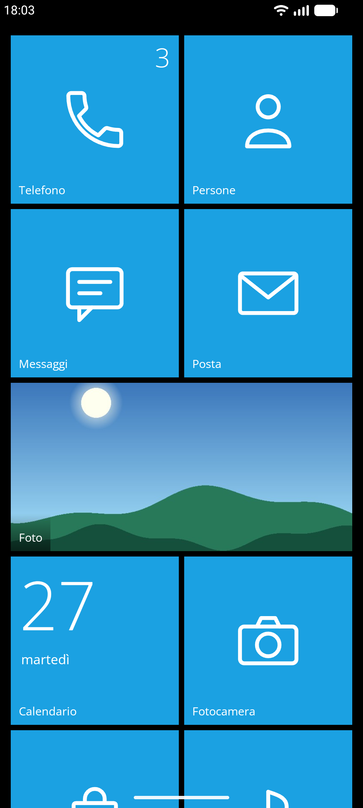
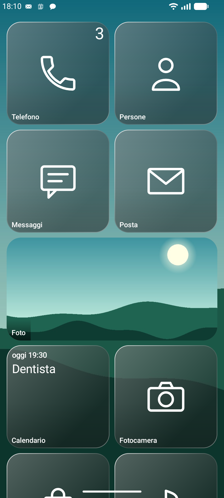
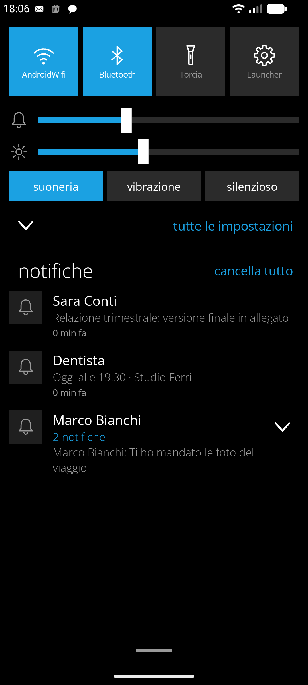
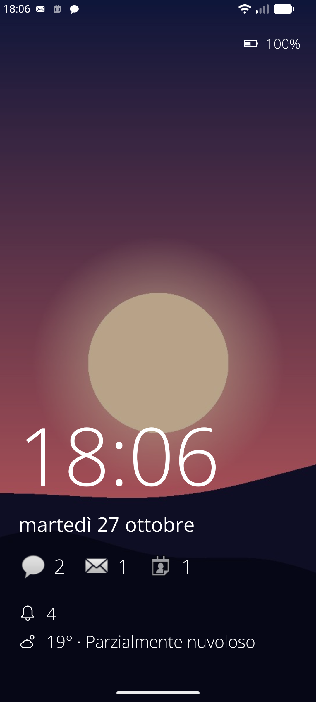
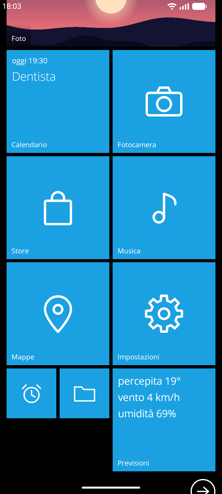
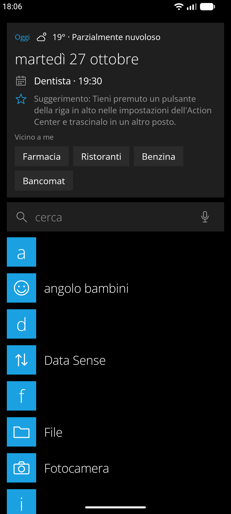
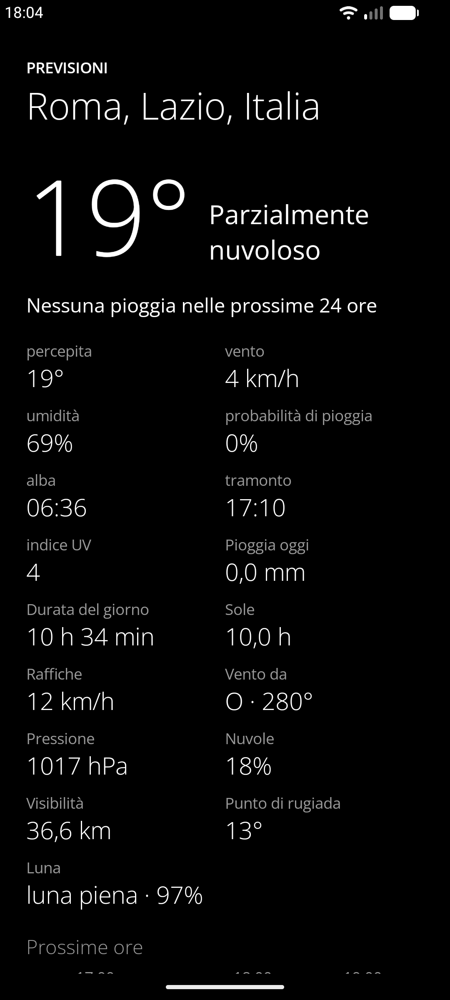
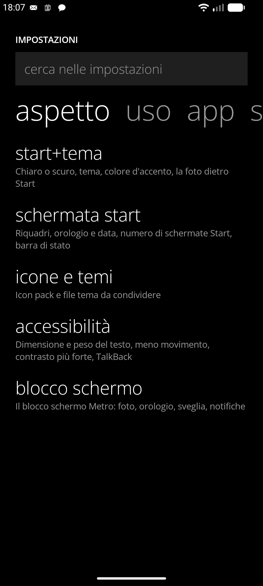

<p align="center">
  
</p>

<h1 align="center">MetroWin Launcher</h1>

<p align="center">
  <b>La schermata Start di Windows Phone, su Android.</b><br>
  Riquadri piatti che girano mostrando contenuti dal vivo, lista app alfabetica, Action Center e blocco schermo Metro.<br>
  Software libero. Niente pubblicità, niente statistiche, nessun servizio di Google obbligatorio.
</p>

<p align="center">
  <a href="https://github.com/developerkenshi-coder/MetroWinLauncher/releases/latest"></a>
  <a href="LICENSE"></a>
  
  <a href="https://github.com/developerkenshi-coder/MetroWinLauncher/releases"></a>
</p>

<p align="center"><a href="README.md">English</a> · <b>Italiano</b></p>

<p align="center">
  
  
  
  
</p>

## Download

**[⬇ Scarica l'ultima versione](https://github.com/developerkenshi-coder/MetroWinLauncher/releases/latest)**: `MetroWinLauncher-26.2S.apk`, per Android 8.0 (API 26) o successivo.

1. Scarica l'APK sul telefono.
2. Aprilo. Quando Android lo chiede, consenti al browser o al gestore di file di installare app sconosciute.
3. Premi Home e scegli **MetroWin Launcher** come app Home. Alla prima apertura parte un breve giro, e ogni permesso è facoltativo.

**F-Droid:** l'autore invierà l'app a F-Droid. Se vuoi pacchettizzarla tu per F-Droid, scrivi prima in una [issue](https://github.com/developerkenshi-coder/MetroWinLauncher/issues).

<details>
<summary>Controlla il download</summary>

L'APK è firmato con questo certificato (SHA-256):

```
B5:E0:52:EB:C5:48:EF:A1:C5:71:6B:85:E0:D2:0F:FC:BC:D3:0E:31:C6:76:1E:BC:C2:34:A9:DD:E7:DF:0C:61
```

Ogni versione ha anche un file `SHA256SUMS`. Per controllare tutti e due:

```sh
shasum -a 256 -c SHA256SUMS
apksigner verify --print-certs MetroWinLauncher-26.2S.apk
```

Android permette di aggiornare l'app solo con la stessa chiave di firma, quindi installa gli aggiornamenti da questa pagina. Una versione
su F-Droid è prevista più avanti; i suoi APK saranno firmati da F-Droid, quindi per passare dall'una all'altra servirà disinstallare
(prima fai un backup dalle impostazioni del launcher).
</details>

## Che cos'è

MetroWin Launcher porta su Android la schermata Start di Windows Phone (Metro, 8 e 8.1): riquadri piatti che girano mostrando contenuti dal vivo,
lista app alfabetica, animazioni a tornello e inclinazione, e le funzioni di sistema che un launcher può davvero offrire. Ha tre aspetti
(*Classic*, *Modern Glass*, *Modern Droid*) con colori personalizzabili, e non fa nulla quando non è sullo schermo.

<details>
<summary>Altri screenshot</summary>
<br>
<p align="center">
  
  
  
  
</p>
</details>

## Funzionalità

### Schermata Start
- **Riquadri** piccoli, medi, larghi e grandi su una griglia a blocchi; il numero di colonne segue la larghezza dello schermo, così i riquadri restano della stessa dimensione in orizzontale e su tablet.
- **Fino a tre schermate Start**, **cartelle** (un riquadro sull'altro, selezione multipla, o «aggiungi a cartella» dalla lista app), trascinamento per riordinare, **annulla**, e **layout con nome** (Casa, Lavoro, Viaggio) da rimettere con un tocco.
- **Stili dei riquadri**: standard con giro, *Iconic* (grande numero e icona), *Cycle* e *collage* per le foto; transizioni a giro o a scorrimento.
- **Aggiungi a Start**: contatti (con la foto), siti web, widget di Android, impostazioni di Android, scorciatoie delle app, numeri di chiamata rapida, note, liste, contatori, conti alla rovescia, timer, un cronometro, un portafoglio per le carte fedeltà.
- **La tua foto dietro Start** con parallasse, zoom e inquadratura, e **colore d'accento preso dalla foto**; orologio e data, un secondo fuso orario, titoli per i gruppi di riquadri.

### Live tile
Ognuno è facoltativo e legge i dati solo finché è fissato su Start.
- **Calendario**, **Foto** (e singoli album), **Persone** (visi, compleanni, gruppi), **Telefono** (chiamate perse).
- **Meteo** con pioggia in arrivo, ora per ora, grafico della temperatura, qualità dell'aria e pollini (Open-Meteo), più **Batteria**, **Torcia**, **Passi**, **Fase della luna**, **Ora nel mondo**, **Spazio** e **Sveglie**.
- **Notizie e Finanza** (spenti finché non li aggiungi): notizie da Google News o da un feed RSS a scelta, cambi e alcune criptovalute.
- **Musica** con copertina e tasti, e i **live tile delle altre app** (WhatsApp, Telegram, Instagram, Reddit, qualsiasi app): il riquadro gira per mostrare la conversazione, l'immagine, l'avanzamento di un download o il brano, leggendo le notifiche di quell'app. Spento finché non lo accendi, con un interruttore per ogni app.

### Lista app e ricerca
- Tutte le app di tutti i profili in ordine alfabetico, con jump list, app recenti (★), più usate, app nuove, **categorie**, scorciatoie delle app, rinomina, nascondi e **blocco di un'app** dietro il blocco schermo.
- **Ricerca indicizzata** che trova le app per nome, iniziali (`gm` per Google Maps), più parole in qualunque ordine, a cosa servono, e perdona gli errori di battitura; cerca anche nelle impostazioni del launcher, in ciò che c'è su Start, nei contatti, nelle impostazioni di Android, negli eventi del calendario e sul web (DuckDuckGo, Google, Bing, Brave, Startpage, Ecosia o Qwant).
- **Risposte rapide** mentre scrivi: calcolatrice, conversioni, valute, date, ora in altre città, timer e sveglie, promemoria, dadi. La chiamata T9 trova i contatti dalle cifre.
- Una scheda **Oggi** con la data, il meteo, il prossimo evento e i promemoria.

### Action Center e notifiche
- Quattro pulsanti rapidi a scelta (altri otto dietro): **Wi-Fi** e **Bluetooth** scrivono la rete e il dispositivo a cui sei collegato, e con un tocco lungo si apre la lista delle reti intorno a te o dei dispositivi abbinati.
- **Volume, suoneria, luminosità**, intensità della torcia, silenzioso a tempo e ore silenziose.
- **Notifiche** che si scartano, a cui **si risponde** dal pannello, **raggruppate per app**, da posticipare, da silenziare per app o per parola chiave, con una breve cronologia. Aprendo un'app le sue notifiche e il numero sul riquadro spariscono.
- Un **banner Metro** e un **Action Center sopra le altre app**, facoltativi (usano un servizio di accessibilità che non legge nulla dallo schermo).

### Blocco schermo, voce e gesti
- Un **blocco schermo Metro** con foto, ora grande, prossima sveglia, notifiche per app, meteo e musica. Android non lascia a un launcher sostituire la sua schermata di blocco: funziona come salvaschermo e ha un'anteprima nel launcher.
- **Comandi vocali** in italiano e inglese, riconosciuti sul telefono se la lingua c'è: apri un'app, chiama qualcuno, imposta un timer o una sveglia, torcia, cerca, meteo e altro.
- **Gesti** a scelta: doppio tocco, swipe a due dita, Home premuto due volte; Indietro predittivo; animazioni di apertura (tornello o espansione).

### Aspetto e colori
- **Classic** (Windows Phone piatto), **Modern Glass** (vetro smerigliato e arrotondato su uno sfondo che brilla) e **Modern Droid** (Material You), ognuno scuro, chiaro, a orario o dal tramonto all'alba.
- I **20 colori di Windows Phone** o un colore tuo, un altro accento di notte, **nero OLED**, dimensione e peso del testo, forma delle icone, **icon pack** (ADW, Nova, Apex, Go) e **file tema** da condividere.

### Backup, profili e accessibilità
- **Backup** del layout in un file o in una cartella (qualsiasi cartella che Android sa aprire), a mano o ogni 1, 7 o 30 giorni, e **sincronizzazione cifrata tra telefoni** attraverso quella cartella (AES-256-GCM, chiave dalla tua passphrase con PBKDF2-SHA256).
- **Profilo di lavoro** e **spazio privato** (Android 15), **Angolo bambini**, e accessibilità: TalkBack su ogni riquadro e riga, dimensione del testo, meno movimento, contrasto più forte.

### Per chi sviluppa un'app
Un'app può scrivere un titolo, una riga e un numero sul **proprio** riquadro, come un live tile di Windows Phone. Vedi [«Per chi sviluppa un'app»](docs/DOCUMENTAZIONE.md#per-chi-sviluppa-unapp-un-tile-tuo-su-start) nella documentazione.

## Privacy e permessi

- **Ogni permesso è facoltativo** e serve a un solo riquadro o a una sola funzione; il giro iniziale chiede ciascuno solo quando arrivi a quella funzione.
- La **rete** serve per il meteo (Open-Meteo; si invia solo la città, in https) e, solo se li aggiungi, per i riquadri Notizie e Finanza. Nessuna statistica, nessuna pubblicità, nessun tracciamento.
- **Nessun servizio di Google è obbligatorio**: il riquadro Notizie legge Google News di base o un feed RSS a tua scelta, la ricerca web usa il motore che scegli, e i collegamenti a mappe, note o calendario aprono l'app che hai per quello.
- Calendario, contatti, foto e registro chiamate si leggono **solo per i riquadri che fissi**; contatori, ricerche e cronologia restano sul telefono e non entrano nei backup.

La tabella completa dei permessi, con a cosa serve ciascuno, è nella [documentazione](docs/DOCUMENTAZIONE.md#permessi).

## Compilare dal sorgente

Servono JDK 17 o successivo e l'Android SDK (piattaforma 36).

```sh
git clone https://github.com/developerkenshi-coder/MetroWinLauncher.git
cd MetroWinLauncher
./gradlew assembleDebug          # app/build/outputs/apk/debug/app-debug.apk
./gradlew assembleOptimized      # la release firmata con la chiave di debug: più leggera per la batteria, si installa sopra la debug
./gradlew testDebugUnitTest      # test di logica e di interfaccia su JVM
```

`assembleRelease` firma con la chiave descritta in `keystore.properties` (`storeFile`, `storePassword`, `keyAlias`, `keyPassword`), che non si
mette mai nel repository; senza quel file l'APK release resta non firmato, come serve a F-Droid.

## Documentazione

La documentazione completa, in italiano, descrive ogni funzione, ogni impostazione, i permessi, la struttura del codice e i limiti di ciò che un launcher può fare su Android:
**[docs/DOCUMENTAZIONE.md](docs/DOCUMENTAZIONE.md)**. La storia delle versioni è in [CHANGELOG.md](CHANGELOG.md).

## Contribuire

Segnalazioni e idee sono benvenute nel [tracker delle segnalazioni](https://github.com/developerkenshi-coder/MetroWinLauncher/issues), in italiano o in inglese.
Per un errore, indica il telefono, la versione di Android e la versione del launcher (*impostazioni → strumenti → informazioni*). Le pull request sono benvenute; per le cose grandi apri prima una segnalazione.

## Licenza e crediti

Rilasciato con licenza **GNU General Public License v3.0 o successiva** ([LICENSE](LICENSE)).
Dati meteo di [Open-Meteo.com](https://open-meteo.com/), licenza CC BY 4.0. Il carattere è Open Sans (SIL Open Font License 1.1). Vedi [THIRD_PARTY_NOTICES.md](THIRD_PARTY_NOTICES.md).

MetroWin Launcher è un progetto indipendente, non affiliato né approvato da Microsoft; Windows Phone è un marchio di Microsoft Corporation.
