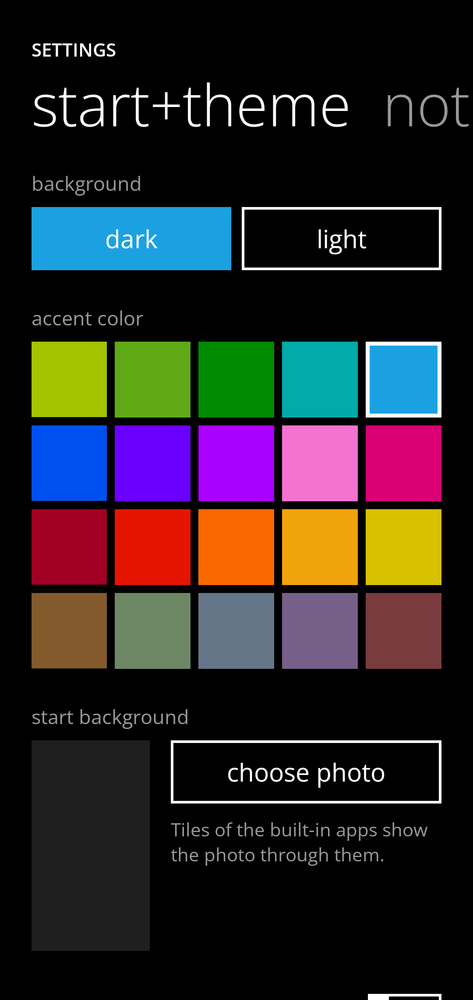
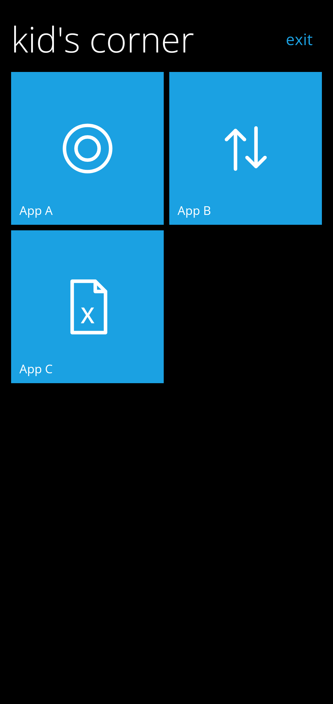

# MetroWin Launcher

Un launcher Android che riproduce la schermata Start di **Windows Phone** (Metro, 8/8.1): riquadri piatti
con live tile che girano, lista app alfabetica, e le animazioni turnstile e tilt, più le funzioni di sistema
che un launcher può davvero fare, come l'Action Center, le cartelle, lo sfondo di Start e il Kid's Corner.

| Start | Cartella aperta | Action Center |
|---|---|---|
|  |  |  |

| Lista app | start+theme | Kid's Corner |
|---|---|---|
|  |  |  |

> Le immagini sono disegnate dai test di screenshot su JVM (vedi [Test](#test)), non catturate da un telefono.

## Cosa c'è

**Schermata Start**
- Riquadri piccoli, medi e larghi su una griglia a blocchi 2x2: quattro piccoli fanno un medio, un largo ne
  occupa due. I riquadri restano nell'ordine in cui li fissi e quelli nuovi vanno in fondo (`data/TileGrid.kt`).
  **Mostra più riquadri** passa da due a tre colonne di riquadri medi.
- Live tile con il flip, che girano in momenti diversi: **Calendario**, **Foto**, **Persone**, **Telefono**
  (chiamate perse). Ogni riquadro mostra il **contatore** delle notifiche della sua app.
- **Trascina per riordinare**: pressione lunga, poi sposti il riquadro (Start scorre da solo vicino ai bordi).
- **Cartelle**: tieni un riquadro fermo sul centro di un altro e lo lasci, e nasce una cartella. Si apre sul posto,
  si rinomina, se ne tolgono le app o la si scioglie. Una cartella con una sola app torna un riquadro.
- Modalità modifica (pressione lunga): rimuovi, ridimensiona, rinomina.
- **Sfondo di Start** con una tua foto: i riquadri delle app integrate diventano trasparenti e la foto scorre più
  piano dei riquadri (parallasse).

**start+theme** (le impostazioni del launcher, un pivot come in Windows Phone, voce nella lista app)
- Sfondo **scuro o chiaro**, i **20 colori d'accento** di Windows Phone 8, sfondo di Start, "mostra più riquadri".
- **notifiche+azioni**: scegli i quattro pulsanti in cima all'Action Center, e attiva l'accesso alle notifiche.
- **Angolo bambini** (Kid's Corner): scegli le app e avvialo.

**Action Center**: si tira giù dall'alto di Start. Quattro pulsanti rapidi (si aprono sugli altri otto), "tutte le
impostazioni", e le **notifiche**, che si scartano una a una trascinandole a destra o tutte con "cancella tutto".
La **torcia** si accende davvero. Wi-Fi, Bluetooth, modalità aereo, ore silenziose, rotazione, posizione, hotspot,
VPN, proietta schermo, luminosità e fotocamera mostrano lo stato (dove Android lo lascia leggere) e aprono la schermata
di sistema giusta: dalla versione 10 di Android un'app non può più accenderli da sola.

**Lista app (menu principale)**
- **Tutte le app** installate che hanno un'icona, di **tutti i profili** (lavoro, clone), con il badge del profilo di
  lavoro. Ordine alfabetico, `#` per numeri e simboli, jump list toccando una lettera, **ricerca** in cima (ignora
  maiuscole e accenti, prima i nomi che iniziano con quello che scrivi).
- Le **36 app stock di Windows Phone 8.1** (Alarms, Calculator, Phone, People, Internet Explorer, Xbox, Battery Saver…)
  compaiono quando il telefono ha un'app che ne fa le veci, **accanto** all'app vera (che resta sempre, con il suo nome):
  "Internet Explorer" vicino a "Chrome". Se hanno lo stesso nome ("Calculator") sono un'unica voce, con il glifo Metro.
- Pressione lunga: aggiungi a Start / rimuovi da Start, disinstalla.

**Animazioni**: turnstile di tile e righe (a cascata, entrata e uscita), tilt alla pressione, flip dei live tile,
scorrimento dei riquadri quando cambia la disposizione, jump list che si gira, transizione a turnstile tra le pagine.

**Schermo a 120 Hz**: il launcher chiede la modalità con il refresh più alto alla risoluzione corrente, e su Android 15
anche la categoria di frame rate alta. Sono richieste: l'ultima parola è del sistema, che può restare a una frequenza più bassa per risparmiare batteria. Le animazioni dipendono
dal tempo, non dai frame: girano uguali a ogni frequenza, solo più fluide.

**Kid's Corner**: Start ristretto alle app che scegli, senza lista app, Action Center né impostazioni. Per uscire si
conferma con il blocco schermo (su un telefono senza blocco esce subito). Se hai attivato lo *screen pinning* nelle
impostazioni di Android, il launcher lo usa per tenere il bambino fuori da Recenti.

## Cosa di Windows Phone non c'è, e perché

Cercato online e valutato: queste cose **non si possono fare da un launcher** (o non ancora).

| Funzione | Stato |
|---|---|
| Schermata di blocco, con le app e lo swipe verso il Kid's Corner | Non si può: la sostituisce solo il sistema. Il Kid's Corner si apre dalla lista app |
| Cortana / tasto Cerca, Word Flow (tastiera), Driving Mode, Wi-Fi Sense | Funzioni di sistema o app a parte |
| Task switcher con pressione lunga su Indietro | È Recenti di Android |
| Accendere Wi-Fi / Bluetooth / aereo dall'Action Center | Android non lo permette più alle app |
| Apps Corner (variante del Kid's Corner) | Il Kid's Corner ne copre l'uso, senza le opzioni sull'Action Center |
| Fissare a Start un contatto, un sito, un luogo | Non ancora (servirebbe accettare le scorciatoie di Android) |
| Ritaglio con pizzico della foto di sfondo | Non ancora: la foto si centra da sola |
| Orizzontale, hub (Persone, Foto, Musica+Video) | Non ancora, gli hub sono app a parte |

## Permessi

Il launcher funziona senza nessun permesso facoltativo. La prima volta una pagina in stile Windows Phone chiede, una
sola volta, quelli per i live tile; ognuno serve a un solo riquadro.

| Permesso | Serve a |
|---|---|
| `QUERY_ALL_PACKAGES` | vedere tutte le app (lista, app stock, profili). Google Play ne limita l'uso e chiede una giustificazione: da verificare se pubblichi l'app |
| `READ_MEDIA_IMAGES` (+ `READ_MEDIA_VISUAL_USER_SELECTED` su Android 14, `READ_EXTERNAL_STORAGE` fino ad Android 12L) | riquadro Foto |
| `READ_CALENDAR` | riquadro Calendario |
| `READ_CONTACTS` | riquadro Persone |
| `READ_CALL_LOG` | riquadro Telefono (chiamate perse) |
| `ACCESS_WIFI_STATE` | stato del pulsante Wi-Fi |
| `REQUEST_DELETE_PACKAGES` | *disinstalla* nel menu |
| Accesso alle notifiche (si attiva nelle impostazioni di Android) | Action Center e contatori sui riquadri |

Il manifest dichiara anche l'attività come **Home** (`HOME` + `DEFAULT`) e le `<queries>` per trovare le app che fanno
da Telefono, Fotocamera, Calendario ecc.

## Come provarlo

Servono JDK 17+ e l'Android SDK (piattaforma 36). Con Android Studio basta aprire la cartella.

```sh
./gradlew assembleDebug          # app/build/outputs/apk/debug/app-debug.apk
adb install -r app/build/outputs/apk/debug/app-debug.apk
```

Poi premi Home: Android chiede quale launcher usare, scegli **MetroWin Launcher** (o *Impostazioni → App →
App predefinite → App Home*). Requisiti: Android 8.0 (API 26) o successivo. Lo schermo è bloccato in verticale, come
lo Start di Windows Phone.

## Test

```sh
./gradlew testDebugUnitTest
```

- Logica pura: griglia a due e tre colonne, operazioni su Start (fissa, sposta, cartelle, pulizia), regole del
  trascinamento, ordine alfabetico, ricerca, salvataggio, scelta del refresh rate, pulsanti rapidi e notifiche.
- Interfaccia su JVM (Robolectric con grafica nativa, `app/src/test/.../screens`): disegna le schermate vere, esegue
  **gesti veri** (trascinare un riquadro, crearne una cartella, scartare una notifica, tirare giù Start) e controlla i
  pixel (tema chiaro, foto in trasparenza, parallasse, entrata a cascata, tilt dal lato del dito). Salva ogni schermata in
  `app/build/screenshots/*.png`, anche a metà animazione.

La prima esecuzione scarica da Maven le librerie di Robolectric (alcune centinaia di MB).

## Struttura

```
app/src/main/java/com/metrowin/launcher/
  MainActivity.kt, LauncherApp.kt, LauncherViewModel.kt   radice, pagine e overlay, stato, 120 Hz
  data/           AppRepository (app, profili, mappa stock), MetroCatalog, AppSections, AppSearch, TileGrid,
                  StartEntries (operazioni su Start), TileStore, SettingsStore, StartBackground, LiveTiles,
                  QuickActions, RefreshRate, IconLoader
  notifications/  NotificationService e NotificationHub
  model/          Tile, Folder, TileSize, AppItem, Glyph
  ui/             start/ (Start, riquadri, cartelle), apps/ (lista, jump list, menu), actioncenter/, settings/,
                  kids/, permissions/, anim/ (turnstile, tilt, flip), components/, theme/
```

## Note

- **Font**: Windows Phone usa Segoe WP, proprietario. Qui c'è Open Sans (OFL), che ha lo stesso aspetto umanista. Vedi
  [THIRD_PARTY_NOTICES.md](THIRD_PARTY_NOTICES.md).
- **Colori d'accento**: Microsoft ha pubblicato la tabella dei 20 colori solo come immagine; i valori vengono da
  trascrizioni (che divergono su qualche sfumatura) e possono differire di poco.
- **Marchi**: i nomi delle app stock (Internet Explorer, Xbox, Skype…) sono quelli di Windows Phone. Stanno in
  `MetroCatalog.kt` e in `strings.xml`, e si cambiano in un punto solo se vuoi pubblicare l'app.
- **Non provato su un telefono**: la verifica è stata fatta compilando (debug e release con R8), con i test e con le
  schermate renderizzate su JVM. Vanno guardati su un dispositivo: i 120 Hz, il servizio delle notifiche, i profili di lavoro,
  la conferma del blocco schermo, lo screen pinning, la torcia e i live tile con foto e contatti veri.
- Versioni: AGP 8.13, Kotlin 2.3, Compose BOM 2025.10. Le librerie AndroidX più recenti chiedono AGP 9 e compileSdk 37.

## Fonti

Le funzioni di Windows Phone sono state cercate qui:
[Windows Phone 8.1](https://en.wikipedia.org/wiki/Windows_Phone_8.1),
[Windows Phone 8](https://en.wikipedia.org/wiki/Windows_Phone_8) e
[Windows Phone](https://en.wikipedia.org/wiki/Windows_Phone) (Wikipedia);
[sfondi di Start](https://blogs.windows.com/devices/2014/04/29/deep-dive-windows-phone-8-1-start-screen-backgrounds/) e
[cartelle](https://blogs.windows.com/windowsexperience/2014/08/05/windows-phone-folders-a-new-way-to-organize-your-start-screen/)
(blog di Microsoft); [Action Center e Quiet hours](https://m.gsmarena.com/windows_phone_81_review-1068p2.php) (GSMArena) e
[Engadget](https://www.engadget.com/2014-04-14-windows-phone-8-1.html);
[Kid's Corner](https://www.windowscentral.com/kids-corner-windows-phone-8),
[Apps Corner](https://www.windowscentral.com/how-to-set-up-apps-corner) (Windows Central);
[temi e colori](https://learn.microsoft.com/it-it/previous-versions/windows/apps/ff402557(v=vs.105)) e
[modelli di live tile](https://learn.microsoft.com/it-it/previous-versions/windows/apps/jj662929(v=vs.105)) (Microsoft Learn);
[i 20 colori](https://marcofranssen.nl/windows-phone-theme-colors).

## Prossimi passi

- Fissare a Start contatti, siti e luoghi (scorciatoie di Android) e ritaglio della foto di sfondo.
- Riquadri "Iconic" e "Cycle" di Windows Phone con le loro regole di contenuto.
- Profilo di lavoro e spazio privato più completi, orizzontale.
