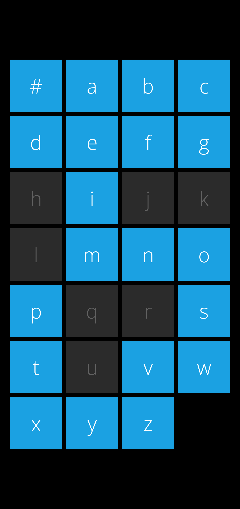
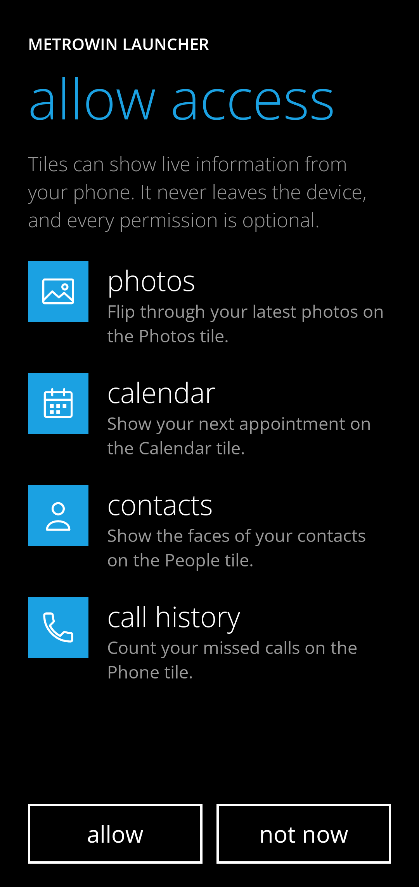

# MetroWin Launcher

Un launcher Android che riproduce la schermata Start di **Windows Phone** (Metro, 8/8.1): riquadri piatti
con live tile che girano, lista app alfabetica con lettere e jump list, e le animazioni turnstile e tilt.

Questa è la prima versione, la base: app, permessi, Start e lista app. Il resto è nella sezione
[Prossimi passi](#prossimi-passi).

| Start | Lista app | Jump list | Permessi |
|---|---|---|---|
|  |  |  |  |

> Le immagini sono disegnate dai test di screenshot su JVM (vedi [Test](#test)), non catturate da un telefono.

## Cosa c'è

**Schermata Start**
- Riquadri piccoli, medi e larghi su una griglia da 4 colonne a blocchi 2x2 (quattro piccoli fanno un medio,
  un largo occupa due blocchi). I riquadri restano nell'ordine in cui li fissi e quelli nuovi vanno in fondo:
  un blocco mezzo vuoto resta com'è (`data/TileGrid.kt`).
- Live tile con il flip di Windows Phone, che girano in momenti diversi: **Calendario** (data e prossimo
  appuntamento), **Foto** (ultime foto), **Persone** (volti dei contatti), **Telefono** (chiamate perse).
- Pressione lunga su un riquadro: modalità modifica con *rimuovi da Start* (✕) e *ridimensiona* (freccia),
  gli altri riquadri si rimpiccioliscono.
- Freccia circolare in fondo ai riquadri, oppure swipe verso sinistra, per aprire la lista app.

**Lista app (menu principale)**
- Tutte le app in ordine alfabetico sotto la loro lettera, con `#` per numeri e simboli (gli accenti non
  contano: *Élan* sta sotto E). Toccando una lettera si apre la **jump list**, con le lettere senza app in grigio.
- Pressione lunga su un'app: *aggiungi a Start* / *rimuovi da Start* e *disinstalla*.

**Animazioni**
- **Turnstile**: i riquadri (e le righe della lista) ruotano attorno al bordo sinistro, a cascata dall'alto,
  quando la schermata si apre; ruotano via, quello toccato per ultimo, prima che l'app si apra.
- **Tilt**: ogni riquadro e riga affonda e si inclina via dal dito, e torna con una molla.
- **Flip** dei live tile, **scorrimento** dei riquadri quando ne cambia la disposizione, **jump list** con i
  quadrati che si girano uno dopo l'altro.

**Le app stock di Windows Phone**

`data/MetroCatalog.kt` elenca le 36 app stock di Windows Phone 8.1 (Alarms, Calculator, Calendar, Camera,
Cortana, Data Sense, Games, Internet Explorer, Mail, Maps, Messaging, Music, People, Phone, Photos, Settings,
Store, Video, Wallet, Xbox, le app Office, Battery Saver, Storage Sense…). Ognuna compare solo se sul
telefono c'è un'app che ne fa le veci (per intent o per package, per esempio il dialer per *Phone*, il
browser predefinito per *Internet Explorer*, l'app Outlook o Gmail per *Mail*), e allora **sostituisce** quell'app
nella lista, con il nome di Windows Phone (tradotto in italiano) e il glifo Metro. Battery Saver, Data Sense e
Storage Sense aprono le rispettive schermate di sistema. Tutte le altre app compaiono con la loro icona,
resa quadrata (i layer delle icone adattive senza maschera).

## Permessi

Il launcher funziona senza nessun permesso: l'elenco delle app arriva da `LauncherApps`, senza
`QUERY_ALL_PACKAGES`. La prima volta una pagina in stile Windows Phone chiede, una sola volta, i permessi
**facoltativi** per i live tile; ognuno serve a un solo riquadro:

| Permesso | Serve a |
|---|---|
| `READ_MEDIA_IMAGES` (+ `READ_MEDIA_VISUAL_USER_SELECTED` su Android 14, `READ_EXTERNAL_STORAGE` fino ad Android 12L) | riquadro Foto |
| `READ_CALENDAR` | riquadro Calendario |
| `READ_CONTACTS` | riquadro Persone |
| `READ_CALL_LOG` | riquadro Telefono (chiamate perse) |
| `REQUEST_DELETE_PACKAGES` (non richiede conferma) | *disinstalla* nel menu |

Il manifest dichiara anche l'attività come **Home** (`HOME` + `DEFAULT`) e le `<queries>` per trovare le app che
fanno da Telefono, Fotocamera, Calendario ecc.

## Come provarlo

Servono JDK 17+ e l'Android SDK (piattaforma 36). Con Android Studio basta aprire la cartella.

```sh
./gradlew assembleDebug          # app/build/outputs/apk/debug/app-debug.apk
adb install -r app/build/outputs/apk/debug/app-debug.apk
```

Poi premi Home: Android chiede quale launcher usare, scegli **MetroWin Launcher** (o *Impostazioni → App →
App predefinite → App Home*). Per tornare al launcher di prima, scegli quello dalla stessa schermata.

Requisiti: Android 8.0 (API 26) o successivo. Lo schermo è bloccato in verticale, come lo Start di Windows Phone.

## Test

```sh
./gradlew testDebugUnitTest
```

- Logica pura: disposizione della griglia (`TileGridTest`), ordine alfabetico e sezioni (`AppSectionsTest`),
  salvataggio dei riquadri e Start predefinito (`TileStoreTest`).
- Interfaccia su JVM (Robolectric con grafica nativa, `app/src/test/.../screens`): disegna le schermate vere,
  verifica che i riquadri entrino a cascata e che il riquadro premuto affondi dal lato del dito, e salva ogni
  schermata in `app/build/screenshots/*.png` per guardarla, anche a metà animazione.

La prima esecuzione scarica da Maven le librerie di Robolectric (alcune centinaia di MB).

## Struttura

```
app/src/main/java/com/metrowin/launcher/
  MainActivity.kt, LauncherApp.kt, LauncherViewModel.kt   radice, pager Start / lista app, stato
  data/    AppRepository (lista app, mappa stock), MetroCatalog, AppSections, TileGrid,
           TileStore, LiveTiles, IconLoader
  model/   Tile, TileSize, AppItem, Glyph
  ui/      start/ (Start, facce dei riquadri), apps/ (lista, jump list, menu), permissions/,
           anim/ (turnstile, tilt, flip), components/ (glifi, testo, icone), theme/
```

## Note

- **Font**: Windows Phone usa Segoe WP, proprietario. Qui c'è Open Sans (Light, Regular, SemiBold), con licenza
  OFL, che ha lo stesso aspetto umanista. Vedi [THIRD_PARTY_NOTICES.md](THIRD_PARTY_NOTICES.md).
- **Marchi**: i nomi delle app stock (Internet Explorer, Xbox, Skype…) sono quelli di Windows Phone. Stanno tutti
  in `MetroCatalog.kt` e in `strings.xml`, e si cambiano in un punto solo se vuoi pubblicare l'app.
- **Non provato su un telefono**: la verifica è stata fatta compilando (debug e release con R8), con i test e con
  le schermate renderizzate su JVM. Il lancio di app reali, i permessi e il flip con foto e contatti veri vanno
  guardati su un dispositivo.
- Versioni: AGP 8.13, Kotlin 2.3, Compose BOM 2025.10. Le librerie AndroidX più recenti chiedono AGP 9 e
  compileSdk 37.

## Prossimi passi

- Trascinare i riquadri per riordinarli (oggi i nuovi vanno in fondo e si può solo ridimensionare o rimuovere).
- Colore d'accento e tema scuro/chiaro (la palette Windows Phone da 20 colori e un selettore).
- Ricerca nella lista app, e animazione di ritorno più fedele all'uscita dalle app.
- Riquadro Messaggi con il conteggio dei non letti (richiede l'accesso alle notifiche).
- Sfondo di Start dietro i riquadri, Action Center, profilo di lavoro, orizzontale.
