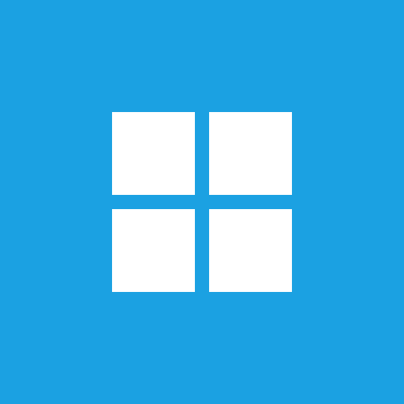
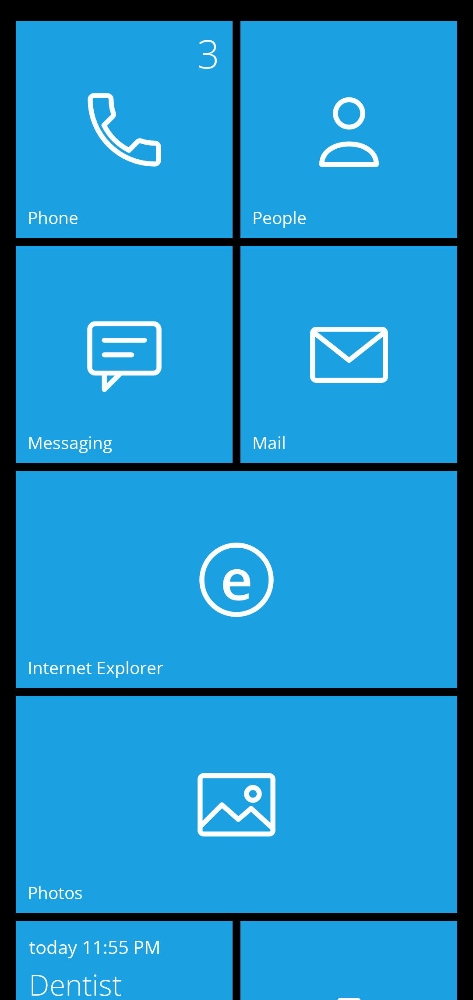
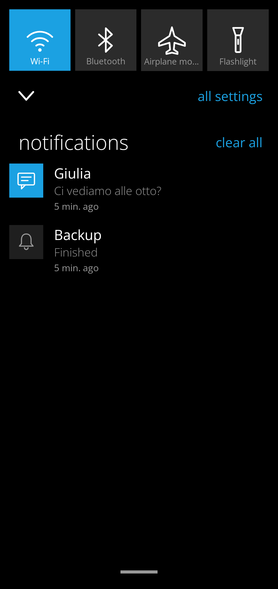
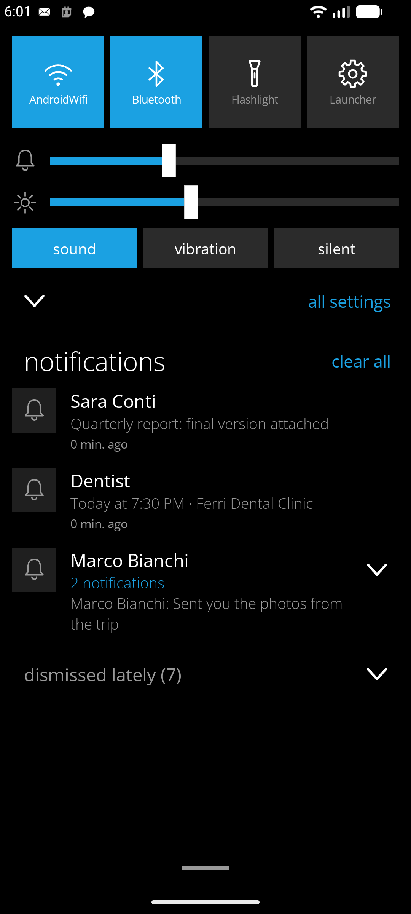
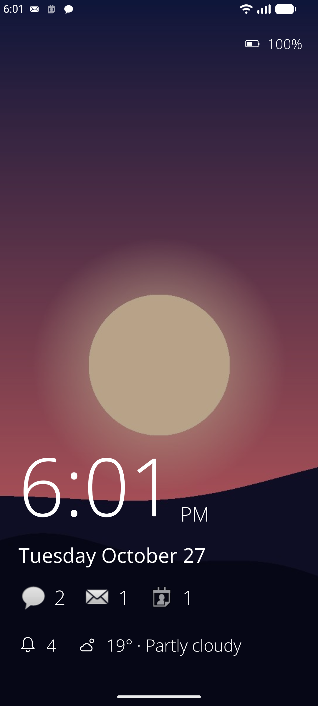
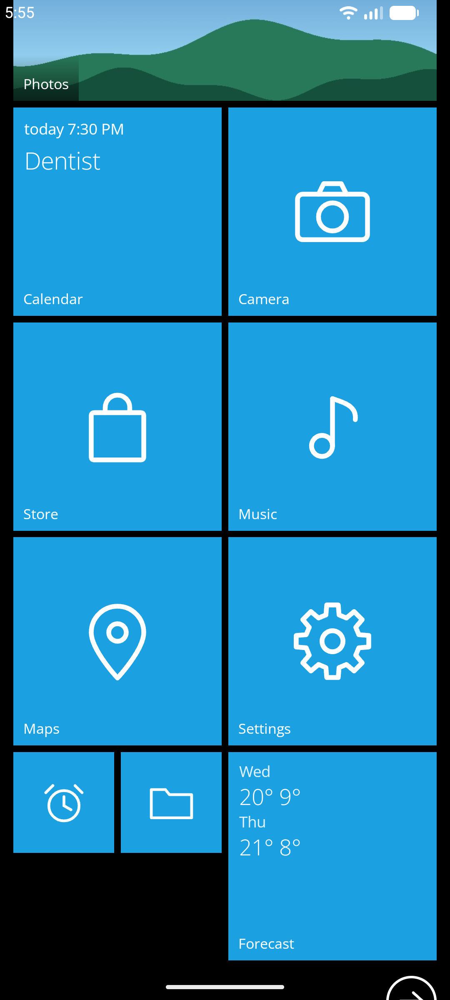
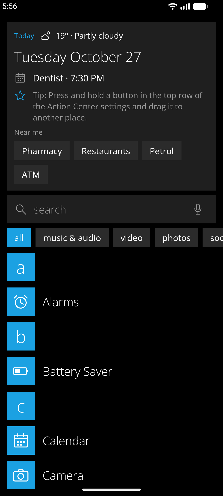
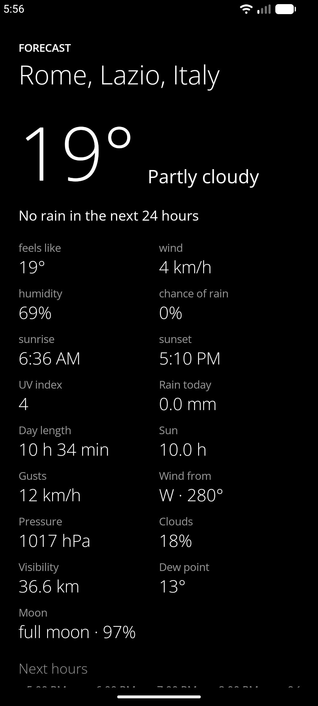
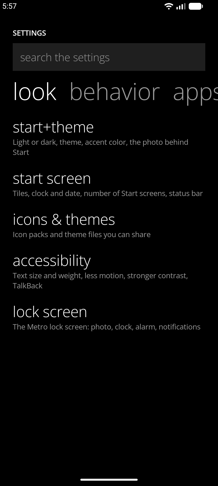

<p align="center">
  
</p>

<h1 align="center">MetroWin Launcher</h1>

<p align="center">
  <b>The Windows Phone Start screen, on Android.</b><br>
  Flat live tiles that flip with real content, an alphabetical app list, an Action Center, and a Metro lock screen.<br>
  Free software. No ads, no analytics, no Google services required.
</p>

<p align="center">
  <a href="https://github.com/developerkenshi-coder/MetroWinLauncher/releases/latest"></a>
  <a href="LICENSE"></a>
  
  <a href="https://github.com/developerkenshi-coder/MetroWinLauncher/releases"></a>
</p>

<p align="center"><b>English</b> · <a href="README.it.md">Italiano</a></p>

<p align="center">
  
  
  
  
</p>

> [!CAUTION]
> **Important Installation Notice:**
> 
> In recent versions of Google Play Services / Google Play Store, Google has begun restricting sideloading for apps not distributed through its official store, flagging them as potentially harmful. I am actively working on resolving this issue, and updates will follow soon. If you wish to install the app and are blocked from doing so, you can temporarily disable Google Play Protect in the Google Play Store settings.

## Download

**[⬇ Get the latest release](https://github.com/developerkenshi-coder/MetroWinLauncher/releases/latest)**: `MetroWinLauncher-26.4S.apk`, for Android 8.0 (API 26) or newer.

1. Download the APK on your phone.
2. Open it. When Android asks, allow your browser or file manager to install unknown apps.
3. Press Home and choose **MetroWin Launcher** as the Home app. The first start shows a short tour, and every permission is optional.

**F-Droid:** the author will submit the app to F-Droid. If you would like to package it for F-Droid yourself, please write in an [issue](https://github.com/developerkenshi-coder/MetroWinLauncher/issues) first.

<details>
<summary>Check the download</summary>

The APK is signed with this certificate (SHA-256):

```
B5:E0:52:EB:C5:48:EF:A1:C5:71:6B:85:E0:D2:0F:FC:BC:D3:0E:31:C6:76:1E:BC:C2:34:A9:DD:E7:DF:0C:61
```

Each release also has a `SHA256SUMS` file. To check both:

```sh
shasum -a 256 -c SHA256SUMS
apksigner verify --print-certs MetroWinLauncher-26.4S.apk
```

Android keeps the app updatable only with the same signing key, so install updates from this page. An F-Droid release is planned
for later; its APKs will be signed by F-Droid, so moving from one to the other will need an uninstall (back up from the launcher's settings first).
</details>

## What it is

MetroWin Launcher brings the Start screen of Windows Phone (Metro, 8 and 8.1) to Android: flat tiles that flip with live content,
an alphabetical app list, turnstile and tilt animations, and the system features a launcher can really offer. It has three looks
(*Classic*, *Modern Glass*, *Modern Droid*) with customizable colors, and it does nothing while it is not on screen.

<details>
<summary>More screenshots</summary>
<br>
<p align="center">
  
  
  
  
</p>
</details>

## Features

### Start screen
- **Tiles** in small, medium, wide and large sizes on a block grid; the number of columns follows the screen width, so tiles keep the same size in landscape and on tablets.
- **Up to three Start pages**, **folders** (drop a tile on another, multi-select, or "add to folder" from the app list), drag to reorder, **undo**, and **named layouts** (Home, Work, Travel) you can switch with one tap.
- **Tile styles**: standard flip, *Iconic* (big number and icon), *Cycle* and *collage* for photos; flip or slide transitions.
- **Add to Start**: contacts (with their photo), websites, Android widgets, Android settings, app shortcuts, quick-dial numbers, notes, lists, counters, countdowns, timers, a stopwatch, a wallet for loyalty cards.
- **Your photo behind Start** with parallax, zoom and framing, and the **accent color taken from the photo**; clock and date, a second time zone, titles for groups of tiles.

### Live tiles
Every one is optional and reads data only while it is pinned to Start.
- **Calendar**, **Photos** (and single albums), **People** (faces, birthdays, groups), **Phone** (missed calls).
- **Weather** with rain-soon, hour by hour, temperature chart, air quality and pollen (Open-Meteo), plus **Battery**, **Flashlight**, **Steps**, **Moon phase**, **World clock**, **Storage** and **Alarms**.
- **News and Finance** (off until you add them): news from Google News or any RSS feed you choose, exchange rates and a few cryptocurrencies.
- **Music** with cover and controls, and the **live tiles of other apps** (WhatsApp, Telegram, Instagram, Reddit, any app): the tile flips to show the conversation, the picture, the download progress or the song, by reading that app's notifications. Off until you turn it on, with a switch for each app.

### App list and search
- All the apps of every profile in alphabetical order, with a jump list, recent apps (★), most used, new apps, **categories**, app shortcuts, rename, hide and **lock an app** behind your screen lock.
- **Indexed search** that finds apps by name, initials (`gm` for Google Maps), several words in any order, what an app is for, and even typos; it also searches the launcher's settings, what is on Start, contacts, Android settings, calendar events and the web (DuckDuckGo, Google, Bing, Brave, Startpage, Ecosia or Qwant).
- **Quick answers** while you type: calculator, unit conversions, currencies, dates, time in other cities, timers and alarms, reminders, dice. A T9 dial finds contacts from digits.
- A **Today** card with the date, weather, next event and reminders.

### Action Center and notifications
- Four quick buttons you choose (eight more behind them): the **Wi-Fi** and **Bluetooth** buttons name the network and the device you are connected to, and a long press lists the networks around you or the paired devices.
- **Volume, ringer, brightness**, flashlight strength, a timed silent mode and quiet hours.
- **Notifications** you swipe away, **reply to** from the panel, **group by app**, snooze, silence per app or by keyword, with a short history. Opening an app clears its notifications and the number on its tile.
- An optional **Metro banner** and an optional **Action Center over other apps** (they use an accessibility service that reads nothing from the screen).

### Lock screen, voice and gestures
- A **Metro lock screen** with photo, big clock, next alarm, notification counts per app, weather and music. Android does not let a launcher replace its lock screen, so it works as the screensaver and has a preview in the launcher.
- **Voice commands** in English and Italian, recognized on the phone when your language is available: open an app, call someone, set a timer or alarm, flashlight, search, weather, and more.
- **Gestures** you configure: double tap, two-finger swipes, home pressed twice; predictive back; open-app animations (turnstile or expand).

### Looks and colors
- **Classic** (flat Windows Phone), **Modern Glass** (frosted, rounded glass over a glowing backdrop) and **Modern Droid** (Material You), each in dark, light, by-the-hour or sunset-to-sunrise.
- The **20 Windows Phone colors** or a color of your own, a different accent at night, **OLED black**, text size and weight, icon shape, **icon packs** from the Play Store (ADW, Nova, Apex, Smart, Go) and **theme files** you can share.

### Backup, profiles and accessibility
- **Backup** of the layout to a file or a folder (any folder Android can open), by hand or every 1, 7 or 30 days, and **encrypted sync between phones** through that folder (AES-256-GCM, key from your passphrase with PBKDF2-SHA256).
- **Work profile** and **private space** (Android 15), **Kids Corner**, and accessibility: TalkBack for every tile and row, text size, reduced motion, stronger contrast.

### For app developers: your own tile on Start

If you develop an app, it can show a title, a short text and a counter on its own Start tile, like the live tiles of
Windows Phone. The tile flips to show the text, and the counter appears as a number. An app can only write to **its own**
tile, never to another app's: the launcher checks which app is actually calling, whatever the call claims.

## Privacy and permissions

- **Every permission is optional** and powers one tile or one feature; the tour asks for each one only when you reach that feature.
- **Network** is used for the weather (Open-Meteo; only the city is sent, over https), and for the news and finance tiles only if you add them. There are no analytics, no ads and no trackers.
- **No Google service is required**: the news tile reads Google News by default or any RSS feed you choose, web search uses the engine you pick, and links to maps, notes or calendar open whatever app you have for them.
- Calendar, contacts, photos and call log are read **only for the tiles you pin**; counters, searches and history stay on the phone and are not part of backups.

The full table of permissions, with what each one is for, is in the [documentation](docs/DOCUMENTAZIONE.md#permessi).

## Build from source

You need JDK 17 or newer and the Android SDK (platform 36).

```sh
git clone https://github.com/developerkenshi-coder/MetroWinLauncher.git
cd MetroWinLauncher
./gradlew assembleDebug          # app/build/outputs/apk/debug/app-debug.apk
./gradlew assembleOptimized      # the release build signed with the debug key: lighter on battery, installs over the debug build
./gradlew testDebugUnitTest      # unit and UI tests on the JVM
```

`assembleRelease` signs with the key described in `keystore.properties` (`storeFile`, `storePassword`, `keyAlias`, `keyPassword`), which is never
committed; without that file the release APK is left unsigned, which is what F-Droid needs.

## Documentation

The complete documentation, in Italian, covers every feature, every setting, the permissions, the architecture and the limits of what a launcher can do on Android:
**[docs/DOCUMENTAZIONE.md](docs/DOCUMENTAZIONE.md)**. The release history is in [CHANGELOG.md](CHANGELOG.md).

## Contributing

Bug reports and ideas are welcome in the [issue tracker](https://github.com/developerkenshi-coder/MetroWinLauncher/issues), in English or Italian.
For a bug, tell us the phone, the Android version and the launcher version (*settings → tools → about*). Pull requests are welcome; please open an issue first for anything big.

## License and credits

Released under the **GNU General Public License v3.0 or later** ([LICENSE](LICENSE)).
Weather data by [Open-Meteo.com](https://open-meteo.com/), licensed CC BY 4.0. Fonts are Open Sans (SIL Open Font License 1.1). See [THIRD_PARTY_NOTICES.md](THIRD_PARTY_NOTICES.md).

MetroWin Launcher is an independent project. It is not affiliated with or endorsed by Microsoft; Windows Phone is a trademark of Microsoft Corporation.
