# MetroWin Launcher

Un launcher Android che riproduce la schermata Start di **Windows Phone** (Metro, 8/8.1): riquadri piatti con live
tile che girano, lista app alfabetica, turnstile e tilt, più le funzioni di sistema che un launcher può davvero fare:
Action Center, cartelle, più schermate Start, widget, ricerca, voce, sincronizzazione cifrata, accessibilità. Ha **tre temi**
(*Classic*, *Modern Glass*, *Modern Droid*) con colori personalizzabili, e **non fa nulla quando non è sullo schermo**.

| Start | Cartella aperta | Action Center |
|---|---|---|
|  | 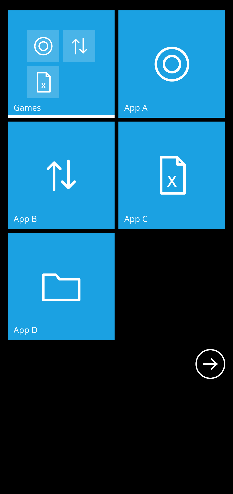 |  |

| Lista app | Impostazioni | Blocco schermo Metro |
|---|---|---|
| 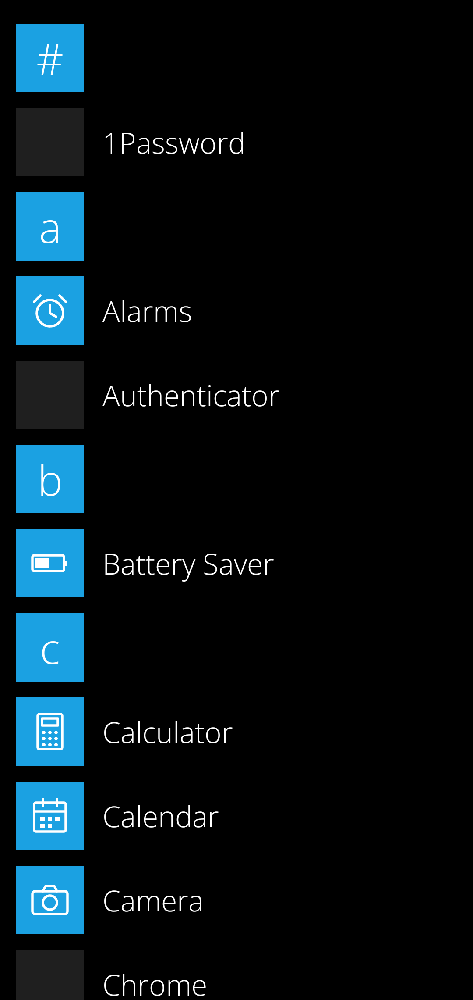 | 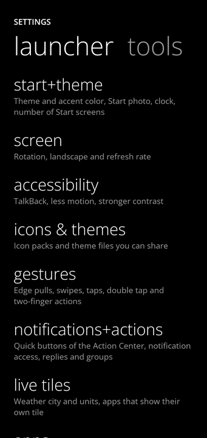 | 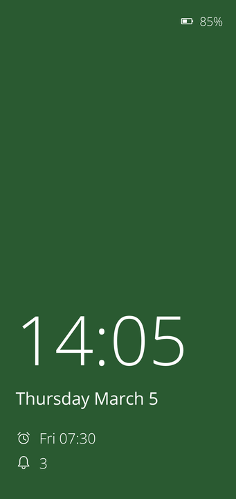 |

| Voce | Notifiche raggruppate | Sincronizzazione |
|---|---|---|
| 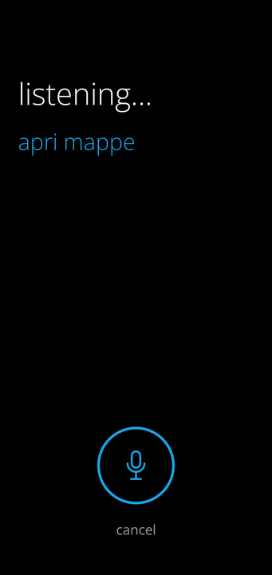 | 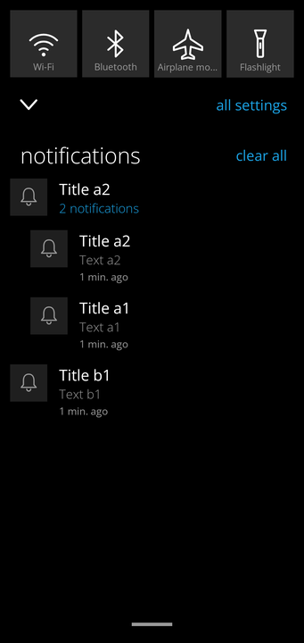 | 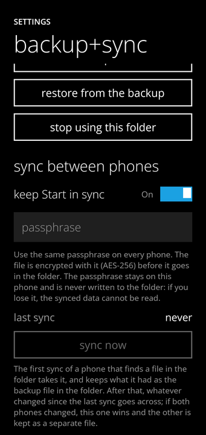 |

I tre temi (Classic, Modern Glass, Modern Droid) sulla stessa schermata Start, e sulle impostazioni:

| Start | Controlli | Impostazioni del tema |
|---|---|---|
| 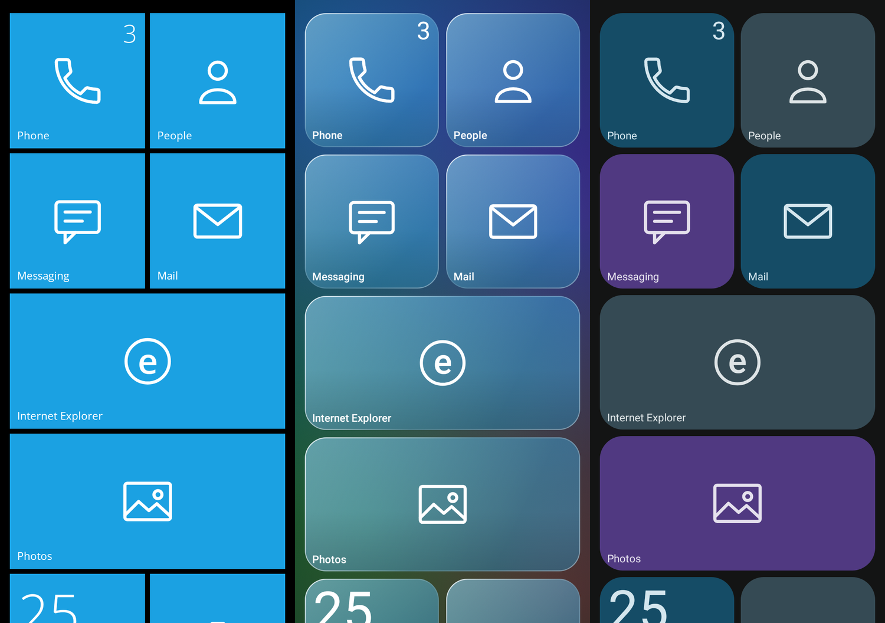 | 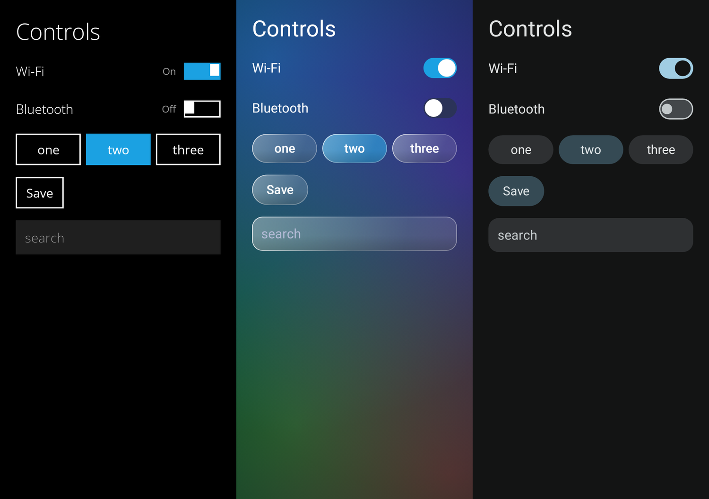 | 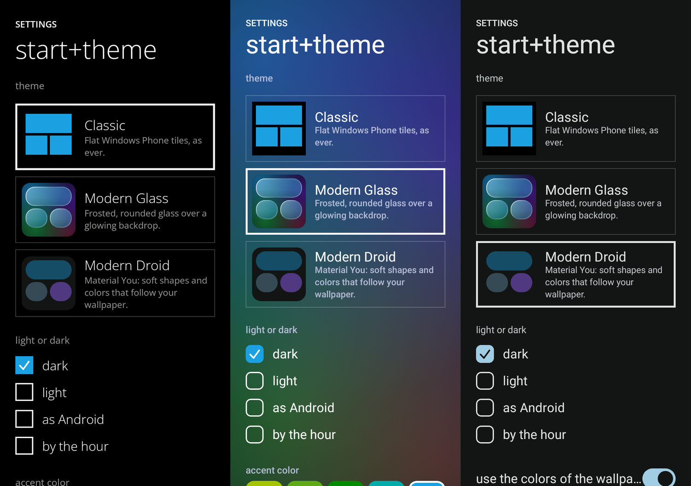 |

Start in orizzontale, con più colonne e riquadri della stessa dimensione che in verticale:

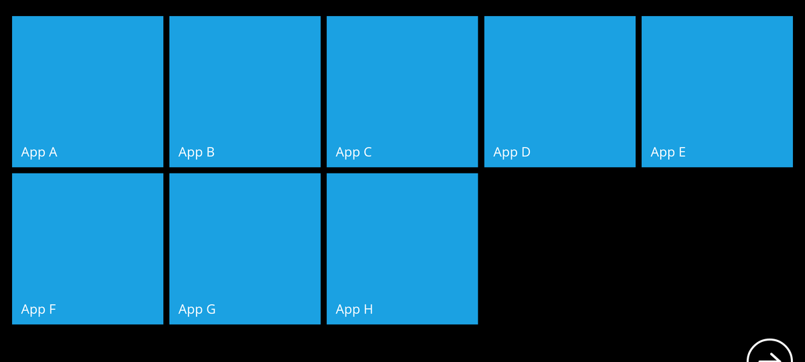

> Le immagini sono disegnate dai test di screenshot su JVM (vedi [Test](#test)), non catturate da un telefono.

## Indice

- [Come provarlo e vederlo in Android Studio](#come-provarlo-e-vederlo-in-android-studio)
- [Il tutorial iniziale](#il-tutorial-iniziale)
- [Cosa c'è](#cosa-cè)
- [Le impostazioni, sezione per sezione](#le-impostazioni-sezione-per-sezione)
- [Cosa non si può fare da un launcher, e come l'ho aggirato](#cosa-non-si-può-fare-da-un-launcher-e-come-lho-aggirato)
- [Permessi](#permessi)
- [Per chi sviluppa un'app: un tile tuo su Start](#per-chi-sviluppa-unapp-un-tile-tuo-su-start)
- [Test](#test)
- [Struttura](#struttura)
- [Note e limiti](#note-e-limiti)

## Come provarlo e vederlo in Android Studio

Servono JDK 17+ e l'Android SDK (piattaforma 36). Android 8.0 (API 26) o successivo.

1. In Android Studio: **Git → Fetch**, poi passa al ramo **`main`** (*Git → Branches → origin/main → Checkout*), oppure
   *File → New → Project from Version Control* con l'indirizzo del repository, e scegli `main`.
2. **File → Sync Project with Gradle Files**.
3. Collega un telefono o avvia un emulatore e premi **Run** (▶).

Da terminale:

```sh
./gradlew assembleDebug          # app/build/outputs/apk/debug/app-debug.apk
adb install -r app/build/outputs/apk/debug/app-debug.apk
```

**Per usarlo tutti i giorni, meglio la build ottimizzata**: è la release (R8, nessun codice di debug, profilo per la compilazione
anticipata di tutto il codice del launcher in `app/src/main/baseline-prof.txt`) firmata con la chiave di debug, quindi si installa sopra
la debug senza perdere i dati. La debug è più lenta e consuma di più: è fatta per sviluppare.

```sh
./gradlew assembleOptimized      # app/build/outputs/apk/optimized/app-optimized.apk
adb install -r app/build/outputs/apk/optimized/app-optimized.apk
```

La `assembleRelease` è la build **ufficiale**: la firma con la chiave descritta in `keystore.properties` (nella radice del progetto, **non nel
repository**: è in `.gitignore`, come la cartella `keystore/`), con le righe `storeFile`, `storePassword`, `keyAlias` e `keyPassword`.
Senza quel file esce non firmata. **Chi perde la chiave non può più aggiornare l'app già installata**: tienine una copia, e la password
a parte. La chiave è diversa da quella di debug, quindi un'installazione di debug va disinstallata prima di mettere quella ufficiale. Il profilo di compilazione lo applica Android da solo, di solito
nella prima notte di manutenzione (a telefono in carica e spento): prima l'avvio è più lento.

Poi premi Home: Android chiede quale launcher usare, scegli **MetroWin Launcher** (o *Impostazioni → App → App
predefinite → App Home*). Alla prima apertura parte il [tutorial](#il-tutorial-iniziale).

## Il tutorial iniziale

Alla prima apertura il launcher mostra un giro di **11 pagine**, nello stile di Windows Phone (titolo piccolo in maiuscolo, titolo
grande in minuscolo con il colore d'accento, un quadrato con il glifo). Ogni pagina spiega una parte del launcher e, se la sua
funzione ha bisogno di un permesso, lo chiede **lì**, con un pulsante, e dice "consentito" quando c'è: niente viene chiesto in anticipo e
niente è obbligatorio. Si va avanti con il pulsante o con uno swipe, si esce con "salta", Indietro torna alla pagina prima.

| Pagina | Cosa spiega | Cosa chiede |
|---|---|---|
| benvenuto | come si usa il giro | — |
| rendilo la tua home | perché serve essere l'app Home | **app Home** (dialogo di Android 10+, altrimenti le impostazioni dell'app Home) |
| la tua schermata start | tocca, tieni premuto, cartelle, tile piccoli affiancati, più schermate, "+" | — |
| live tile | tile che girano e i loro stili | **foto**, **calendario**, **contatti**, **cronologia chiamate** (uno per uno) |
| meteo | il tile del meteo e dove si sceglie la città | **posizione** |
| tutte le tue app | jump list, ricerca, menu, voce | **microfono** |
| action center | tirata dal bordo, pulsanti, notifiche, risposta e gruppi | **accesso alle notifiche** (pagina di Android) |
| il tuo aspetto | i tre temi e i colori | — |
| gesti | bordi, doppio tocco, due dita, Indietro | **servizio di blocco** (accessibilità, facoltativo) |
| tienilo attivo | perché Android chiude le app e come evitarlo; che stare attivo non costa batteria | **nessuna ottimizzazione della batteria**; e, sui telefoni che hanno un elenco "avvio automatico", di aggiungerci il launcher |
| rendilo tuo | tutte le sezioni delle impostazioni | — |

| Benvenuto | Live tile e permessi | Tienilo attivo |
|---|---|---|
| 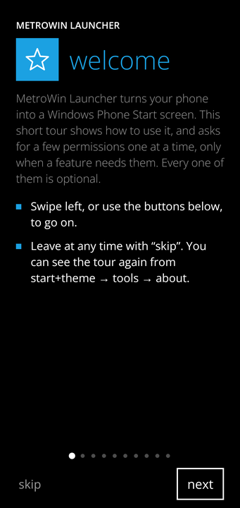 | 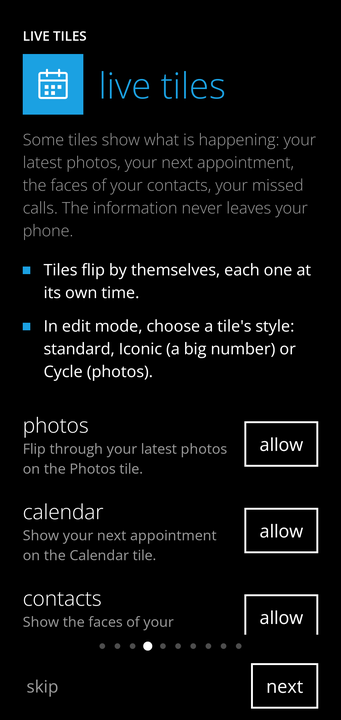 | 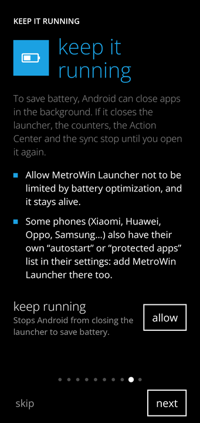 |

Quello che si concede nelle impostazioni di Android (home, notifiche, accessibilità, batteria) viene riletto quando si torna al
launcher, e il pulsante diventa "consentito". Un permesso che Android non chiede più (negato due volte) fa diventare il pulsante
"apri impostazioni", che porta alla pagina dell'app. Il giro si rivede da *start+theme → tools → about → rivedi il tutorial*.

## Cosa c'è

### Start e lista app

- **Riquadri** piccoli, medi e larghi su una griglia a blocchi 2x2 (`data/TileGrid.kt`). Il numero di colonne segue la
  larghezza dello schermo (`TileGrid.columnsFor`): 4 in verticale su un telefono, 6 con "mostra più riquadri", di più in
  orizzontale o su un tablet, così i riquadri restano grandi uguali invece di allargarsi.
- **Fino a tre schermate Start**, con i puntini della pagina, e "sposta alla schermata" dalla barra di modifica.
- **Riquadri piccoli affiancati**: quattro riquadri piccoli stanno in un blocco 2x2. Mentre ne trascini uno, le celle libere
  accanto ad altri riquadri piccoli si mostrano come quadrati vuoti: lascialo lì e si affianca agli altri, con il vicino che
  non si sposta. Così usi tutto lo spazio e fai gruppi **senza cartelle**. Sul bordo di un riquadro piccolo il trascinamento
  riordina, solo il suo centro fa una cartella (più piccolo che sui riquadri grandi). Le celle libere sono sempre quelle di un
  blocco che ha già riquadri piccoli: il layout resta un flusso in ordine, quindi non c'è un punto vuoto a piacere.
- **Lo spazio vuoto accanto ai riquadri**: quando dopo quattro riquadri piccoli (o dopo un riquadro medio) viene un riquadro largo,
  il blocco accanto resta vuoto perché il largo non ci sta. Trascinando un riquadro che sta **più in basso** nell'ordine, quel blocco
  si mostra come un'area vuota: un riquadro piccolo (in una delle quattro celle) o medio (nell'area intera) ci va, e il largo
  resta sulla sua riga. Un riquadro largo non ci sta, e per un riquadro che sta più in alto del vuoto si riordina dal bordo
  (togliendolo, quelli dopo risalirebbero e lo spazio si sposterebbe, quindi non si può mostrare con sicurezza dove finisce).
- **Stili dei riquadri**: standard (con flip), **Iconic** (grande numero e icona) e **Cycle** (foto che si alternano).
- **Live tile**: Calendario, Foto, Persone, Telefono, **Meteo** (Open-Meteo), **Batteria** (carica, tempo alla ricarica),
  **Torcia** (si accende davvero), e le **notifiche** che girano sul riquadro dell'app (*notification peek*).
- **Trascina per riordinare**, modifica con rimuovi, ridimensiona, rinomina, e la barra di modifica con il pulsante *aggiungi*.
- **Cartelle con più app**: tre modi. Un riquadro tenuto sul centro di un altro; il pulsante cartella della barra di modifica,
  che apre la **selezione multipla** (tocchi i riquadri, vedi la spunta e "N selezionati", e *crea cartella*: se tra loro c'è
  già una cartella, gli altri entrano lì); oppure **"aggiungi a cartella"** dal menu di un'app nella lista, che sceglie tra le
  cartelle che hai. Sul riquadro della cartella le prime app sono quadratini e, se sono più di quattro, l'ultimo dice **+N**.
- **Impostazioni Launcher** è un'app della lista (con il glifo dell'ingranaggio, in ordine alfabetico) e un pulsante tra i
  quattro toggle dell'Action Center (chi aveva i quattro toggle di prima ha il nuovo al posto dell'ultimo; chi li aveva scelti
  a mano non li vede cambiare).
- **Aggiungere a Start**: un **contatto** (con la foto), un **sito web**, un **widget** di Android (ospitato dal
  launcher, con la dimensione che segue il riquadro).
- **Orologio e data** sopra i riquadri; **sfondo di Start** con una tua foto (riquadri trasparenti, parallasse) e
  **colore d'accento dalla foto** (il colore dominante, tra i 20 di Windows Phone).
- **Lista app**: tutte le app di tutti i profili, ordine alfabetico, jump list con la **★ delle app recenti**, **ricerca**
  che ignora maiuscole e accenti e che trova anche **contatti**, **schermate delle impostazioni di Android** e, in
  fondo, una **ricerca sul web** (DuckDuckGo). **Nascondi app** dal menu (si riportano indietro dalle impostazioni).
- Le **36 app stock di Windows Phone 8.1** compaiono accanto all'app vera che ne fa le veci (con il glifo Metro).

### Gesti e navigazione

- **Il dito comanda, sempre.** Action Center, pagine e Indietro seguono il dito uno a uno; le regole di rilascio sono
  funzioni pure con test (`PullRules`). Tirata dal bordo alto da ogni pagina, pagine che ruotano un poco con il dito,
  **Indietro predittivo** (il gesto di sistema muove lo schermo), ritorno alla home senza sfarfallii.
- **Gesti configurabili**: doppio tocco su Start, swipe a due dita in giù e in su; ognuno può bloccare lo schermo, aprire
  le impostazioni o l'Action Center, andare alla lista app, accendere la torcia, aprire la fotocamera, **parlare**,
  cercare o **aprire le app recenti**. **Suono e vibrazione** al tocco, facoltativi.
- **App recenti subito**: l'azione *apri le app recenti* (come gesto, come pulsante tra i toggle dell'Action Center e come
  **tile delle Impostazioni rapide**, che si aggiunge dalla pagina *gesti* e funziona da qualsiasi app) usa lo stesso servizio
  di accessibilità del blocco schermo (`GLOBAL_ACTION_RECENTS`), che non legge nulla e non chiede eventi: si apre al tocco, senza
  gesto da tenere. **Lo swipe di Android** (su e tieni) **non è del launcher**: lo gestisce il sistema, e con un launcher che non
  è quello del telefono può avere un'attesa che da qui non si può togliere (vedi *Note e limiti*).
- **Animazione di apertura**: *turnstile* (i riquadri si girano, l'ultimo quello toccato) oppure **espansione** (Start
  resta fermo e l'app cresce dal riquadro toccato, o dal centro se tocchi dalla lista).

### Action Center e notifiche

Quattro pulsanti rapidi a scelta (sugli altri otto si apre il resto), notifiche che si scartano a destra o tutte insieme,
**risposta rapida** dai messaggi a cui l'app permette di rispondere, **raggruppamento per app** (una riga che si apre; scorrerla via
le scarta tutte). Wi-Fi, Bluetooth, aereo ecc. mostrano lo stato e aprono la schermata di sistema giusta (da Android 10
un'app non può più accenderli da sola); la torcia si accende davvero.

### Voce

Il microfono nella casella di ricerca (o un gesto a scelta) apre una schermata di ascolto in stile Metro. Il
riconoscimento è quello del telefono (`SpeechRecognizer`), con preferenza per il modello **sul telefono** se esiste per la
tua lingua; il launcher capisce i comandi da solo (`data/VoiceCommands.kt`, italiano e inglese, nessuna rete):
*apri Mappe*, *chiama Anna* (trova il numero e apre il tastierino con il numero già scritto, a un tocco dalla chiamata; con l'interruttore
*chiama subito* e il permesso del telefono, che Android chiede la prima volta, la chiamata parte da sola), *timer 10 minuti*, *sveglia alle 7 e 30*,
*accendi / spegni la torcia*, *cerca ricette di pizza* (o una frase qualsiasi, che va alla ricerca web), *meteo*,
*blocca lo schermo*, *centro notifiche*, *tutte le app*, *impostazioni del launcher*, *apri Wi-Fi* (le impostazioni di Android).
Tra le alternative del riconoscitore sceglie la prima che è un comando vero.

### Profili

Profilo di lavoro e **spazio privato** (Android 15): si riconoscono per tipo, hanno ciascuno il proprio badge sull'icona, si
**mettono in pausa e si riattivano** dalle impostazioni, e si può scegliere di mostrare o nascondere le loro app nella lista.

### Blocco schermo Metro

Android non lascia a un launcher la sostituzione della schermata di blocco. Quello che c'è, e funziona senza trucchi:
- la **schermata Metro** (foto, ora grande e leggera in basso, data, prossima sveglia, numero di notifiche, batteria; swipe in
  su per uscire, con il rimbalzo se lasci prima) come **salvaschermo** di Android (*Impostazioni → Schermo → Salvaschermo*),
  che compare mentre il telefono si ricarica o sta su un dock;
- una **anteprima** nel launcher;
- la **foto** del blocco schermo, che si può impostare anche come sfondo della schermata di blocco di Android.

### Temi e colori

Tre aspetti, da *start+theme*, scuri o chiari (o a orario) tutti e tre. Lo stile cambia forme, superfici, tipo di lettere e
controlli (pulsanti, interruttori, campi, cursori), non la struttura: i gesti e la disposizione sono gli stessi.

- **Classic**: il launcher come era, riquadri piatti e quadrati, lettere sottili, interruttore con "On/Off", tilt alla pressione.
- **Modern Glass**: vetro smerigliato **disegnato da zero** su uno sfondo che brilla (macchie di luce nel colore d'accento e
  in due sue variazioni di tonalità): riquadri e pannelli arrotondati, trasparenti, con riflesso in alto a sinistra, ombra
  sotto e bordo luminoso; pulsanti a capsula, interruttore tondo bianco, campi arrotondati. Il vetro è un'illusione
  (velo trasparente, riflesso, bordo): non sfoca davvero quello che sta dietro, perché un launcher non può sfocare altre finestre.
- **Modern Droid**: Material You. I riquadri prendono a turno tre **contenitori tonali** (come le schede di Android), angoli
  grandi, pulsanti a pillola, interruttore con il cursore grande che cresce da acceso. I colori sono quelli dello **sfondo del
  telefono** da Android 12 (`system_accent1…neutral2`, mappati sui toni di Material), oppure, se lo spegni o il telefono è
  più vecchio, costruiti dal colore d'accento scelto: toni che hanno la stessa *luminosità percepita* (L\* di Lab) per ogni tinta, così il
  testo si legge per tutti i 20 colori (lo controlla un test).
- **Colori**: i **20 di Windows Phone**, oppure un **colore tuo** con tre cursori (tonalità, intensità, luminosità) e
  un'anteprima; "torna ai 20 colori" lo toglie. Vale per tutti e tre gli stili. Un colore d'accento dalla foto di Start è
  sempre quello dei 20 e il colore tuo lo spegne; il file tema porta con sé stile e colore tuo.

- **Nero OLED** (*start+theme*, interruttore): per gli schermi OLED, nel tema scuro lo sfondo è nero vero in tutti e tre gli stili, quindi
  quei pixel sono spenti (più contrasto, meno batteria). Classic era già nero: cambiano i menu e le barre, che si fanno più scuri.
  Modern Glass perde il fondale blu e tiene solo un bagliore leggero dei colori; Modern Droid passa dal grigio scuro al nero. Nel tema
  chiaro non fa nulla. Non so dire quanta batteria faccia risparmiare: dipende da quanto schermo è sfondo e non riquadri.

### Live tile delle altre app

Con l'accesso alle notifiche e l'interruttore *contenuti dal vivo delle altre app* (pagina *notifiche+azioni*, spento finché non lo
accendi: metterebbe il testo dei messaggi su Start), il riquadro di **WhatsApp, Telegram, Instagram, Reddit** o di qualsiasi altra
app si gira per mostrare cosa succede, **leggendo le sue notifiche** (nessuna rete, nessun permesso in più; non uso le API delle
app, che non ci sono):

- **Conversazioni**: una faccia per ogni chat, con chi ha scritto, l'ultima riga, il nome del gruppo e **la foto di chi scrive**
  (i messaggi sono quelli che l'app scrive nella notifica a conversazione, `MessagingStyle`). Il contatore somma i messaggi uno per
  uno: una chat con cinque in attesa fa 5, non 1.
- **Altre notifiche** (un mi piace su Instagram, una risposta su Reddit, un'email): titolo e riga, con la foto di chi le manda se c'è.
- **Immagini**: una notifica con un'immagine (`BigPicture`, o una foto in chat) riempie il riquadro, con le sue parole sotto.
- **Musica che suona**: titolo, artista e copertina dalla sessione multimediale dell'app (Spotify, YouTube Music, qualsiasi
  lettore), con un triangolo se suona e due barre se è in pausa; compare anche sul riquadro **Musica**, qualunque app suoni.
- **Avanzamento**: un download, un upload, una sincronizzazione, con la percentuale e una barra.
- **In corso adesso**: una navigazione, una chiamata, un cronometro, con un puntino che dice che è dal vivo.
- Cosa mostrare e chi no, nella pagina *live tile*: conversazioni, immagini, musica, avanzamento, **nascondi cosa c'è scritto**
  (resta solo chi ha scritto), e un interruttore **per ogni app** che ha qualcosa da mostrare. Ogni riquadro ha al massimo cinque
  facce; i riquadri piccoli mostrano solo il contatore.
- Costo: il servizio che già legge le notifiche le legge in dettaglio solo quando l'interruttore è acceso, e decodifica le foto
  una volta sola (copie piccole: 96 px, 192 px, 320 px). Il resto del lavoro è sulle regole in `notifications/LiveCards.kt`, che sono
  funzioni pure con test.

### Icone e temi

**Icon pack** di ADW, Nova, Apex e Go Launcher (si legge l'`appfilter.xml`): sostituiscono le icone delle app per cui
hanno un'icona; le app senza icona nel pack possono essere vestite con il suo sfondo (`iconback`, `iconupon`, `scale`). Le app
Metro del telefono tengono i loro glifi. **File tema**: colori, scuro/chiaro/a orario, orologio, dimensione dei riquadri e icon
pack in un piccolo file JSON da condividere, che applica solo quelle chiavi e non tocca altro.

### Backup e sincronizzazione

- **Backup** del layout (Start, scorciatoie, impostazioni) in un file, o in una **cartella** che scegli con il selettore di
  file di Android (anche una cartella di Google Drive), a mano o ogni 1, 7 o 30 giorni. Quello che è solo di questo telefono
  (cartella, passphrase, posizione del meteo, foto, Angolo bambini acceso) non viaggia.
- **Sincronizzazione tra telefoni** attraverso la stessa cartella: il file `metrowin-sync.bin` è **cifrato** (AES-256-GCM,
  chiave dalla tua passphrase con PBKDF2-SHA256, sale e nonce nuovi a ogni scrittura, intestazione autenticata). La passphrase
  non è mai scritta nella cartella. Un telefono che trova un file la prima volta lo prende e salva ciò che aveva come file di
  backup nella cartella; dopo passa solo ciò che è cambiato; se sono cambiati entrambi vince questo telefono e l'altro resta
  nella cartella come `metrowin-sync-other-<ora>.bin`. Si sincronizza quando il launcher si apre, quando lo lasci e a richiesta.

### Tile pubblicati dalle app

Un'app può mettere un titolo, una riga di testo e un numero sul **proprio** tile, come un live tile di Windows Phone
(vedi [più sotto](#per-chi-sviluppa-unapp-un-tile-tuo-su-start)).

### Altre trenta funzioni

Tutte si spengono o si scelgono nelle impostazioni (pagine *app*, *gesti*, *notifiche+azioni*, *start+theme*); quelle che toccano
dati dell'app (conteggi, ricerche recenti) restano sul telefono e **non entrano nei backup**.

**Lista app**
1. **Scorciatoie delle app**: tenendo premuta un'app, il menu elenca quelle che l'app offre (*nuovo messaggio*, *scheda in incognito*…).
   Android le dà **solo al launcher che è l'app Home del telefono**: finché non lo è, il menu non ne ha (non si rompe niente).
2. **Più usate**: un gruppo in cima alla lista con le (al massimo quattro) app aperte dal launcher almeno tre volte.
3. **Nuove**: le app installate nell'ultima settimana (al massimo tre). Subito dopo aver configurato o ripristinato un telefono non
   se ne indica nessuna, perché sarebbero tutte.
4. **Categorie**: pastiglie sotto la casella di ricerca che mostrano solo le app di un tipo (giochi, social, musica…). Ci sono solo le
   app che **dichiarano** cosa sono: molte non lo fanno e restano fuori dai filtri.
5. **Rinomina**: dal menu di un'app; il nome nuovo vale ovunque (lista, riquadri, ricerca, voce). *Nome originale* lo toglie. Il menu ha anche
   *informazioni sull'app* (la schermata di Android).
6. **Blocco app**: un'app può chiedere il blocco schermo (PIN, sequenza, impronta) prima di aprirsi **dal launcher** (lista, riquadri,
   ricerca, voce). Non è una cassaforte: l'app si apre ancora da una notifica, dalle recenti o da un'altra app. Serve un blocco schermo
   impostato in Android.

**Ricerca**
7. **Calcolatrice**: `12*3+4`, `(2+3)^2`, `15% di 80`, `100+10%`, `radice(16)`, la virgola decimale. Tocchi la risposta e il risultato si copia.
8. **Conversioni**: `5 km in miglia`, `30 c in f`, `70 kg in lb`, `100 km/h in mph`, `2 gb in mb`: lunghezze, pesi, temperature, volumi, velocità,
   dati (a 1000, come le impostazioni di Android) e tempo, in italiano e in inglese. Le valute stanno a parte e sono spente (vedi la 43).
9. **Numeri, link, indirizzi mail**: un numero offre *chiama* e *scrivi*, un indirizzo web *apri*, una mail *scrivi a*.
10. **Motore di ricerca web**: DuckDuckGo (predefinito), Google, Bing, Brave, Startpage, Ecosia o Qwant. Si apre nel browser solo quando tocchi la riga.
11. **Ricerche recenti**: le ultime sei compaiono toccando la casella, con *cancella*.
12. **Timer e sveglie**: `timer 10 minuti`, `timer 1h30`, `sveglia alle 7 e 30`, `sveglia 7:30`, anche a voce. Parte nell'app Orologio del telefono.

**Start**
13. **Colore del riquadro**: il pulsante sul riquadro selezionato apre i 20 colori (o il colore del tema).
14. **Annulla**: dopo aver tolto, ridimensionato, colorato o spostato un riquadro, o cambiato una cartella, una barra per sei secondi offre di
    annullare l'ultima modifica (un riquadro tolto con la sua nota o il suo numero torna com'era; un widget no: libera subito il suo posto).
15. **Impostazioni di Android su Start**: dal **+** della barra di modifica, ad esempio *Wi-Fi* o *Batteria*, come riquadri.
16. **Chiamata rapida**: dal **+**, un numero scelto dai contatti (con la sua foto) che si chiama con un tocco. Senza il permesso del telefono apre il tastierino.
17. **Nota**: un riquadro su cui scrivi; il testo si vede sulla faccia, un tocco lo modifica.
18. **Conto alla rovescia**: un nome e una data; il riquadro dice i giorni che mancano (e li conta in su dopo la data).

**Live tile di sistema**
19. **Spazio**: il riquadro *Storage Sense* dice quanto è libero e quanto è pieno il telefono.
20. **Sveglia**: il riquadro *Sveglie* dice quando suona la prossima.
21. **Dettagli del meteo**: temperatura percepita, vento, umidità, probabilità di pioggia, alba, tramonto e indice UV, su una terza faccia del
    riquadro e nella pagina del meteo, con la probabilità di pioggia di ogni giorno.

**Gesti e Action Center**
22. **Altre azioni per i gesti**: screenshot, menu di spegnimento, schermo diviso, e le notifiche e le impostazioni rapide **di Android** (tramite il
    servizio di accessibilità che già blocca lo schermo). C'è anche il pulsante *Screenshot* tra quelli dell'Action Center.
23. **Un'app su un gesto**: doppio tocco e i due swipe a due dita possono aprire l'app che scegli.
24. **Volume e suoneria** nell'Action Center: cursore del volume dei contenuti e i pulsanti suoneria, vibrazione, silenzioso (il silenzioso chiede l'accesso a
    *non disturbare*, e senza porta alla schermata che lo dà).
25. **Luminosità**: un cursore, con l'accesso *modifica le impostazioni di sistema* che dai in una schermata di Android (finché non c'è, il cursore lo dice).
26. **Tocca l'orologio**: l'ora di Start apre l'orologio, la data il calendario.

**Aspetto**
27. **Dimensione del testo**: dall'85% al 130% per tutto il launcher.
28. **Orologio**: ore a 12 o 24 a scelta, prossima sveglia sotto la data, numero della settimana.
29. **Barra di stato nascosta** su Start. Con la barra nascosta lo swipe dal bordo alto è del sistema (la fa riapparire): l'Action Center si apre con
    un gesto della pagina gesti.
30. **Inquadratura della foto di Start**: zoom da 100% a 300% e due cursori per il punto che resta in vista, con anteprima.

### Altre trenta funzioni, secondo giro

Anche queste si spengono o si scelgono nelle impostazioni. Contatori, liste, note e scelte restano sul telefono; i riquadri nuovi
entrano nel backup del layout (la lista, il contatore e le città sì, i compleanni vengono letti dai contatti e non si salvano).

**Start**
31. **Nomi sotto i riquadri** a scelta: spenti, restano solo le immagini.
32. **Ripristina Start**: rimette i riquadri dell'installazione e toglie quelli che hai aggiunto (contatti, siti, note, widget…). Due tocchi, e *annulla* li riporta
    tutti tranne i widget. Il numero di schermate resta quello che hai scelto.
33. **Tieni premuto sul vuoto di Start** e si apre il menu *aggiungi*, senza dover selezionare prima un riquadro. Il menu ora scorre.
34. **Scorciatoie delle app come riquadri**: nel menu di un'app, il **+** accanto a una scorciatoia (*nuovo messaggio*…) la mette su Start con l'icona dell'app.
    Vale solo se il launcher è l'app Home (stessa regola della funzione 1) e il riquadro parte solo da lì.
35. **Contatore**: un riquadro con un numero; un tocco aggiunge uno, il **−** toglie uno, la matita cambia nome e lo azzera. Mai sotto zero.
36. **Lista**: spunte e cancellazioni dentro una finestra, il riquadro dice *2 di 5* e le prime cose ancora da fare. Fino a 40 voci.
37. **Ora in un'altra città**: 58 città, cercate in italiano o in inglese; il riquadro dice l'ora (e *domani* / *ieri* quando il giorno è diverso).
38. **Fase della luna**: un disco con la parte illuminata, il nome e la percentuale. È calcolata dal mese lunare, senza rete; sbaglia al massimo di un giorno
    attorno alle fasi.
39. **Compleanni**: dai contatti (serve `READ_CONTACTS`, chiesto una volta quando metti il riquadro): il più vicino in grande, i prossimi sull'altra faccia, con gli anni che compie quando
    il contatto ha l'anno. Il 29 febbraio si festeggia il 28 negli anni senza.
40. **Spaziatura dei riquadri**: stretta, normale o larga.

**Lista app e ricerca**
41. **Elenco compatto**: quadrati più piccoli e righe più strette.
42. **Apri nello store** e **condividi il link** dal menu di un'app (la pagina nello store del telefono, o sul web se non c'è).
43. **Valute** (spento): `100 usd in eur`, `50 dollari in euro`, `€10 in yen`. I tassi sono quelli della Banca centrale europea tramite `api.frankfurter.dev`: **una**
    richiesta ogni sei ore al massimo, solo https, che non porta con sé niente di ciò che scrivi; senza rete valgono gli ultimi tassi, con la loro data.
44. **Ora nel mondo**: `ora a Tokyo`, `che ore sono a New York`, `time in london`.
45. **Date**: `tra 30 giorni`, `in 2 weeks`, `45 giorni fa`, `giorni al 25 dicembre`, `days until christmas`, e Natale, Capodanno, Pasqua (calcolata), Ferragosto…
46. **Eventi del calendario** (spento, `READ_CALENDAR`): gli eventi dei prossimi sei mesi il cui titolo corrisponde. Si apre l'evento nel calendario.
47. **Dado e moneta**: `dado`, `2d6+3`, `d20`, `lancia una moneta`, `testa o croce`. Un tocco rilancia.

**Voce**
48. **Volume e luminosità**: `alza il volume`, `volume al 50 per cento`, `luminosità al massimo`. La luminosità chiede lo stesso accesso del cursore.
49. **Suoneria**: `modalità silenziosa`, `vibrazione`, `attiva la suoneria` (il silenzioso chiede l'accesso a *non disturbare*).
50. **Naviga** e **messaggio**: `portami a Roma` apre le indicazioni nell'app di mappe; `scrivi a Marco ci vediamo alle otto` apre l'app messaggi con il testo scritto: **non lo
    invia**, lo invii tu. Per un nome di due parole si dice *dicendo*: `scrivi a Maria Rossi dicendo ciao`.
    Funzioni di sistema a voce: `screenshot`, `menu di spegnimento`, `app recenti`, `schermo diviso` (tramite il servizio di accessibilità).

**Action Center e notifiche**
51. **Ore silenziose subito**: con l'accesso a *non disturbare* il pulsante le accende e spegne sul posto (prima apriva solo la schermata). Senza accesso apre la schermata che lo dà.
52. **Posticipa una notifica**: tenendola premuta compaiono 15 minuti, 1 ora, 3 ore, le 8:00; Android la riporta da solo.
53. **Impostazioni di notifica dell'app**: dalla stessa pressione lunga.
54. **Intensità della torcia**: un cursore sotto i pulsanti, solo con la torcia accesa e solo sui telefoni che lo permettono (Android 13 e successivi, se l'hardware ha più livelli).

**Aspetto e sistema**
55. **Testo marcato**: tutti i pesi di tre passi più pesanti (come il testo in grassetto di Android, che lo accende da solo).
56. **Carattere del telefono** al posto di quello del tema.
57. **Scuro dal tramonto all'alba**: segue alba e tramonto del meteo (la città del riquadro; il meteo deve essersi caricato una volta, altrimenti valgono le ore).
58. **Lingua del launcher** (Android 13 e successivi): inglese o italiano a prescindere dal telefono. Compare anche nelle impostazioni di Android, per app.
59. **Schermata di blocco** con il meteo e il prossimo evento (nelle prossime 24 ore). Il meteo è quello già salvato, il blocco non scarica nulla. L'evento è **spento** di
    base: chiunque veda lo schermo lo legge.
60. **Home premuto due volte** fa quello che scegli nei gesti (come gli altri gesti, anche un'app).

### Orizzontale

Si sceglie in *schermo*: **solo verticale** (come prima), **segui la rotazione del telefono** (rispetta il blocco di Android)
o **solo orizzontale**. In orizzontale Start e le altre pagine tengono fuori dai bordi laterali il ritaglio della fotocamera.

### Accessibilità

- **TalkBack**: ogni riquadro e riga è un pulsante che si legge e si attiva (prima il launcher usava solo il tocco, che
  TalkBack non vede); un riquadro dice quante notifiche ha, una cartella quante app contiene; nel menu azioni di TalkBack
  un riquadro offre **stacca, cambia dimensione, sposta prima, sposta dopo** (cartelle: rinomina, scomponi), cioè
  tutto quello che altrimenti richiede una pressione lunga e un trascinamento. I controlli disattivati si dichiarano tali.
- **Riduci il movimento** (si attiva anche quando Android ha le animazioni a zero): le schermate sfumano invece di girare,
  i riquadri entrano tutti insieme, non si inclinano alla pressione, i live tile non girano e le foto non si alternano da sole.
- **Alto contrasto**: cornice bianca sui riquadri, pieni anche sopra la foto di Start, testo grigio a colore pieno.

### Batteria

Il launcher fa lavorare il telefono il meno possibile. Quello che segue è ciò che il codice fa e che i test controllano;
quanta batteria faccia risparmiare in ore **non è stato misurato** (servirebbe un telefono e una settimana di uso).

- **A riposo non fa nulla.** Quando un'altra app è davanti, o lo schermo è spento, il launcher non ha timer, non ascolta la batteria
  né il risparmio energetico di Android, non segue la torcia, non aggiorna l'orologio. Gli orologi, i giri dei riquadri, il
  controllo dell'ora del tema a orario e l'aggiornamento dell'Action Center sono sospesi dal ciclo di vita dello schermo
  (`LaunchedWhileStarted`, `repeatOnLifecycle(STARTED)`): partono da capo quando si torna, e quello che è cambiato nel frattempo
  si legge una volta sola.
- **Il servizio di blocco non chiede eventi** (prima chiedeva i cambi di finestra, e quindi svegliava il processo a ogni cambio di app).
- **Le notifiche non si leggono a launcher chiuso.** Il servizio delle notifiche Android lo tiene vivo tutto il giorno, e prima a
  ogni notifica, anche con un'altra app davanti, chiedeva ad Android *tutte* le notifiche attive, le ricopiava, decodificava le
  immagini e interrogava la sessione multimediale: un telefono che ne riceve di continuo (un download, la musica, un contapassi)
  teneva il processo sveglio per ore. Era la causa più probabile del tempo "in background" segnalato da Android. Ora (`NotificationPacer`,
  `NotificationHub.startWatching`): con il launcher fuori dallo schermo una notifica che arriva è solo ricordata, senza nessuna
  lettura; si legge **una volta** quando lo schermo torna; a launcher aperto una raffica si legge al massimo due volte al secondo; e
  la musica non viene riletta a ogni notifica delle altre app. Android continua a consegnare le notifiche al servizio (non si può
  evitare senza perderle): quello è lavoro del sistema, non più nostro. Lo stesso per il salvaschermo (conta come schermo acceso finché
  è visibile).
- **La lista delle app non si ricarica a launcher chiuso.** Gli aggiornamenti delle app arrivano tutto il giorno, ognuno con più
  eventi, e a ognuno il launcher rileggeva *tutte* le app e svuotava la cache delle icone. Ora (`DeferWhileAway`) si ricorda che qualcosa
  è cambiato e si rilegge una volta al ritorno. Anche la sincronizzazione all'uscita, se accesa, non parte più di una volta ogni 15
  minuti (prima ogni minuto).
- **Si legge solo quello che serve**: contatti, calendario, foto e chiamate solo per i live tile fissati su Start, e **ognuno col suo
  passo** (`PowerPolicy.liveMaxAgeMs`): prossimo evento, chiamate perse e sveglia ogni due minuti al massimo, spazio ogni dieci,
  foto ogni quarto d'ora, volti ogni mezz'ora, compleanni (che scorrono tutti i contatti) ogni dodici ore; con il risparmio sei volte
  più rado, mai oltre un giorno. Le foto e i volti già decodificati si riusano: una lettura che trova le stesse non ne decodifica
  nessuna. Meteo ogni mezz'ora al massimo, e dopo un tentativo, riuscito o no, si aspettano dieci minuti (senza rete prima si riprovava
  a ogni ritorno su Start); la ricerca degli icon pack ogni cinque minuti; la sincronizzazione all'avvio ogni quindici. Un permesso dato
  o tolto, o un tile nuovo, fanno rileggere subito.
- **I 120 Hz solo mentre usi lo schermo.** Prima la richiesta restava fissa, e Start è la schermata che resta accesa più a lungo: a
  120 Hz anche quando nessuno la tocca. Ora (`RefreshRate.wantsHigh`) la frequenza alta si chiede al tocco e quando il launcher torna
  sullo schermo, e tre secondi dopo l'ultimo tocco si toglie e decide il telefono (clock e giri dei riquadri sono basati sul tempo:
  a 60 Hz si vedono uguali). Si toglie solo se lo schermo dice di poter cambiare frequenza senza lampeggi (`alternativeRefreshRates`,
  Android 12 e oltre); altrimenti resta come prima. Non l'ho provato su un telefono vero: se su un telefono la frequenza non risale
  al tocco, l'impostazione *massima frequenza di aggiornamento* si può spegnere.
- **Schermata di blocco e salvaschermo**: l'orologio si aggiorna ogni minuto, ma il calendario (una query) si interroga ogni cinque
  minuti, o subito quando l'evento è iniziato. Un'app che pubblica sul proprio tile le stesse parole non fa scrivere nulla su disco né
  ridisegnare il tile, e il provider non decodifica più tutte le impostazioni a ogni chiamata.
- **Risparmio energetico** (pagina *batteria*): *automatico* (quando c'è il risparmio di Android, o la batteria è al 20% o meno e
  non è in carica), *sempre* o *mai*. Mentre risparmia: i riquadri non girano da soli, le foto non si alternano, la richiesta dei
  120 Hz viene tolta, e tutto si legge meno spesso (meteo 2 ore, dati dei tile 15 minuti, sync quattro volte più rada).

**Misurare su un telefono vero.** Tutto quello che sopra è controllato dai test è logica; i consumi reali si misurano sul telefono.
`tools/battery-report.sh collect` (si esegue sul computer a cui il telefono è collegato con il debug USB, serve adb; solo lettura:
non installa e non cambia nulla, e non serve azzerare niente, perché Android tiene le statistiche dall'ultima carica) raccoglie in un archivio: tempo del processo per stato
(in primo piano, servizio, in cache), tempo di CPU, wakelock, sveglie, lavori, quante notifiche arrivano e da quali app, la fascia di
standby, la frequenza dello schermo e le righe di log del launcher. Legge soltanto; non raccoglie il contenuto delle notifiche. Non è
stato provato su un telefono: i comandi `dumpsys` cambiano un poco da una versione di Android all'altra.

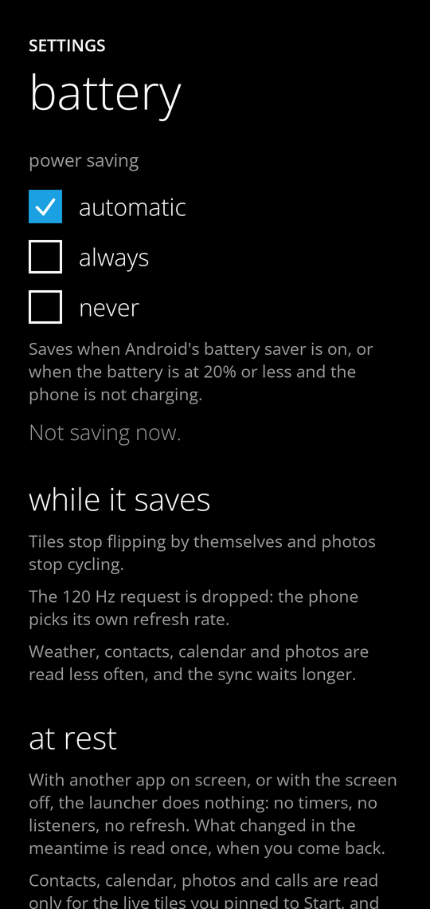

### Angolo bambini

Start ristretto alle app che scegli, senza lista app, Action Center né impostazioni. Per uscire si conferma con il blocco
schermo. Lo stato "acceso" non viaggia nei backup, così un file non può mai accenderlo su un altro telefono.

## Le impostazioni, sezione per sezione

Si aprono dalla voce *Settings* nella lista app. Sono due pagine di un pivot (come in Windows Phone), ogni sezione ha la
sua pagina; tutto è salvato come un unico JSON (`SettingsCodec`) che legge anche le versioni vecchie.

**launcher**

| Sezione | Cosa c'è |
|---|---|
| start+theme | **tema** (Classic, Modern Glass, Modern Droid) e, per Droid, i colori dello sfondo; scuro / chiaro / come il telefono / a orario / **dal tramonto all'alba**; colore d'accento (20), **colore tuo con i cursori** o dalla foto; foto di Start, **inquadratura** e parallasse; più riquadri; **nomi e spaziatura dei riquadri**; numero di schermate Start; **ripristina Start**; orologio (ore, sveglia, settimana, tocchi); **dimensione del testo**; **testo marcato**; **carattere del telefono**; barra di stato nascosta; nero OLED |
| schermo | rotazione (verticale, segui il telefono, orizzontale); **lingua del launcher**; animazione di apertura; massima frequenza di aggiornamento (120 Hz, tolta mentre si risparmia batteria) |
| batteria | risparmio energetico (automatico, sempre, mai) e cosa cambia; cosa il launcher non fa quando non è sullo schermo |
| accessibilità | riduci il movimento; alto contrasto; TalkBack e scorciatoia alle impostazioni di Android |
| icone e temi | icon pack; esporta e importa un file tema |
| gesti | tirata dal bordo, indietro dal bordo, doppio tocco, **Home premuto due volte**, due dita in giù e in su (*app recenti*, screenshot, menu di spegnimento, schermo diviso, pannelli di Android, **un'app a scelta**), suono e vibrazione, servizio di accessibilità |
| notifiche+azioni | i quattro pulsanti dell'Action Center; **volume, luminosità, suoneria e torcia** nel pannello, **ore silenziose subito**, posticipa notifiche; accesso alle notifiche; mostra le notifiche sui riquadri; risposta rapida; raggruppamento |
| live tile | città del meteo (ricerca o posizione) e gradi; **contenuti dal vivo delle altre app** (interruttore, accesso alle notifiche, cosa mostrare, app per app) e **cosa legge ora il launcher**; lascia pubblicare i tile alle app, ed elenco di chi l'ha fatto |
| app | gruppi in cima alla lista (più usate, nuove), filtro per categoria, **elenco compatto**; cosa cerca la ricerca (contatti, impostazioni, **calendario**, web), **motore**, risposte, **valute**, ricerche recenti; app nascoste, rinominate e bloccate |

**tools**

| Sezione | Cosa c'è |
|---|---|
| blocco schermo | anteprima, foto, cosa mostrare (anche **meteo** e **prossimo evento**), foto nella schermata di blocco di Android, impostazioni del salvaschermo |
| voce | microfono nella ricerca; riconoscimento sul telefono; *chiama subito*; prova; cosa si può dire |
| profili | lavoro e spazio privato: pausa e riattiva; mostra le loro app |
| backup | file o cartella, ogni quanto, ripristina; sincronizzazione con passphrase; esporta e importa |
| angolo bambini | app e avvio |
| informazioni | versione e dettagli del launcher |

## Cosa non si può fare da un launcher, e come l'ho aggirato

| Funzione di Windows Phone | Stato |
|---|---|
| Schermata di blocco al posto di quella di Android | Non si può: la sostituisce solo il sistema. C'è come **salvaschermo** e come foto del blocco (vedi sopra) |
| Accendere Wi-Fi / Bluetooth / aereo dall'Action Center | Android non lo permette più alle app: i pulsanti aprono la schermata giusta |
| Chiamare un contatto a voce | Fatto: tastierino con il numero (un tocco), oppure chiamata diretta se la attivi e dai il permesso del telefono |
| Cortana, Word Flow (tastiera), Driving Mode, Wi-Fi Sense, task switcher | Funzioni di sistema o app a parte |
| Start e lista app affiancati in orizzontale | Non fatto: in orizzontale sono due pagine come in verticale, con più colonne |
| Ritaglio con pizzico della foto di sfondo | Fatto in altro modo: **zoom e due cursori di posizione** con anteprima (non il pizzico) |
| Sincronizzare la foto di Start e quella del blocco | Non fatto: le foto sono file di questo telefono |

## Permessi

Il launcher funziona senza nessun permesso facoltativo. Li chiede il [tutorial](#il-tutorial-iniziale), uno per pagina, e
si possono dare anche dopo, quando serve la funzione.

| Permesso | Serve a |
|---|---|
| `QUERY_ALL_PACKAGES` | vedere tutte le app. Google Play ne limita l'uso e chiede una giustificazione: da verificare se pubblichi l'app |
| `READ_MEDIA_IMAGES` (+ `READ_MEDIA_VISUAL_USER_SELECTED` su Android 14, `READ_EXTERNAL_STORAGE` fino ad Android 12L) | riquadro Foto |
| `READ_CALENDAR`, `READ_CONTACTS`, `READ_CALL_LOG` | riquadri Calendario, Persone (e ricerca contatti), Telefono; la ricerca negli eventi e il prossimo evento sul blocco (`READ_CALENDAR`, spenti); i **compleanni** (`READ_CONTACTS`) |
| `INTERNET` | il meteo (solo Open-Meteo, solo https, risposta limitata a 256 KB) e la ricerca di una città; i tassi di cambio (solo `api.frankfurter.dev`, https, spenti di base) |
| `ACCESS_COARSE_LOCATION` | "usa la mia posizione" del meteo (l'ultima nota, una volta) |
| `RECORD_AUDIO` | la voce, quando la usi la prima volta |
| `CALL_PHONE` | chiamare **subito** (riquadro chiamata rapida, voce con *chiama subito*). Si chiede quando metti un riquadro di chiamata rapida o accendi l'interruttore; senza, si apre il tastierino con il numero |
| `com.android.alarm.permission.SET_ALARM` | timer e sveglie dalla ricerca e dalla voce (permesso normale, concesso all'installazione) |
| `WRITE_SETTINGS` (accesso speciale) | solo il cursore della **luminosità** dell'Action Center: lo dai tu, in una schermata di Android, e il cursore lo dice finché non c'è |
| `SET_WALLPAPER` | la foto nella schermata di blocco di Android, quando lo chiedi |
| `ACCESS_WIFI_STATE`, `REQUEST_DELETE_PACKAGES` | stato del Wi-Fi, *disinstalla* nel menu |
| `REQUEST_IGNORE_BATTERY_OPTIMIZATIONS` | solo per chiedere, nel tutorial, che Android non chiuda il launcher in background. **Google Play lo consente solo ad alcuni tipi di app**: per una build non pubblicata sullo store va bene, per pubblicarla va giustificato o tolto (basta rimuovere la pagina "tienilo attivo") |
| `com.metrowin.launcher.permission.PUBLISH_TILE` | **dichiarato dal launcher**, lo chiedono le app che vogliono un tile (vedi sotto) |
| Accesso alle notifiche (nelle impostazioni di Android) | Action Center, contatori, risposta rapida, raggruppamento, **posticipa** |
| Accesso a *non disturbare* (nelle impostazioni di Android) | il pulsante *ore silenziose* e il silenzioso: li accendono sul posto |
| Servizio di accessibilità del launcher (facoltativo) | **blocco schermo, app recenti, screenshot, menu di spegnimento, schermo diviso**, pannelli di Android: azioni che solo un servizio può fare; non legge nulla dello schermo |
| Cartella scelta con il selettore di file | backup e sincronizzazione: il launcher raggiunge solo quella cartella |

Il backup automatico di Android è disattivato (`allowBackup=false`, e regole esplicite per Android 12): le impostazioni
contengono la passphrase della sincronizzazione.

## Per chi sviluppa un'app: un tile tuo su Start

L'app **A** può scrivere sul **proprio** riquadro (mai su quello di un'altra: il launcher guarda chi chiama, qualsiasi
cosa dica la chiamata). Nel manifest di A:

```xml
<uses-permission android:name="com.metrowin.launcher.permission.PUBLISH_TILE" />
<queries><provider android:authorities="com.metrowin.launcher.tiles" /></queries>   <!-- Android 11+ -->
```

Nel codice:

```kotlin
val tiles = Uri.parse("content://com.metrowin.launcher.tiles")
val extras = Bundle().apply {
    putString("title", "Posta")               // al massimo 60 caratteri, una riga
    putString("text", "3 nuovi messaggi")     // al massimo 160
    putInt("count", 3)                        // il numero sul riquadro, 0..99999
}
val answer = context.contentResolver.call(tiles, "publish", null, extras)
// answer?.getBoolean("accepted"); se è false, answer?.getString("reason")
context.contentResolver.call(tiles, "clear", null, null)      // toglie il testo
```

Il testo compare sul riquadro (che gira per mostrarlo), il numero come contatore. L'utente può spegnere la cosa (*live tile → tile
pubblicati dalle app*) e cancellare quello di un'app. Il permesso è di livello `normal`: Android lo concede all'installazione, ma
solo se il launcher c'era già.

## Test

```sh
./gradlew testDebugUnitTest lintDebug
./gradlew assembleRelease        # con R8
```

**1480 test**, nessuno saltato; il lint non ha errori.

- Logica pura: griglia e colonne dalla larghezza, operazioni su Start, regole di trascinamento e di rilascio, ricerca,
  salvataggio e migrazione delle impostazioni, comandi vocali, pianificazione della sincronizzazione, **cifratura** (anche
  file alterati, passphrase sbagliata, numero di iterazioni ostile), tema, icon pack (`appfilter.xml`), tile pubblicati,
  raggruppamento delle notifiche, piano dell'animazione di apertura, regole di accessibilità.
- Interfaccia su JVM (Robolectric con grafica nativa, `app/src/test/.../screens`): disegna le schermate vere, esegue
  **gesti veri** e controlla i pixel; salva ogni schermata in `app/build/screenshots/*.png`. Esempi: tile in orizzontale con
  le dimensioni giuste, risposta rapida che arriva all'app come risultato del `RemoteInput` (con un `PendingIntent` vero),
  swipe del blocco schermo con rimbalzo, azioni di TalkBack che fanno quello che dicono.

- **Testi che entrano sempre** (`TextFit*`, `screens/TextFitTest.kt`): ogni schermata, menu, finestra, barra e riquadro viene disegnato
  nei casi peggiori (italiano, che ha le parole lunghe; testo al 130% e al 170%; schermo largo 320 dp; schermo in orizzontale;
  i tre aspetti Classic, Glass e Droid; inglese) e a ogni testo si chiede com'è stato disposto: un testo tagliato ("…"), una
  parola spezzata a metà, un testo fuori dallo schermo o sopra un altro è un errore del test. `MetroText` va a capo, e se lo spazio è
  troppo stretto per la parola più lunga, o troppo basso per le righe, disegna il testo più piccolo (fino a metà) invece di tagliarlo;
  i riquadri e i pulsanti dell'Action Center non crescono oltre il 130% del testo; le finestre e i pannelli scorrono invece di
  uscire dallo schermo. Quello che scrive l'utente (il nome di un'app, una nota) può finire con "…" in una lista, e lì i test usano nomi brevi.
  Provato su JVM con font di prova: non l'ho visto su un telefono.

I test hanno trovato anche difetti veri, poi corretti: la semantica dei riquadri stava prima dello `offset`, quindi per un
servizio di accessibilità stavano tutti nell'angolo della griglia; i pulsanti usavano solo il tocco e non erano attivabili da TalkBack.

La prima esecuzione scarica da Maven le librerie di Robolectric (alcune centinaia di MB).

## Struttura

```
app/src/main/java/com/metrowin/launcher/
  MainActivity.kt, LauncherApp.kt, LauncherViewModel.kt   radice, pagine e overlay, stato, rotazione, 120 Hz
  data/           applicazioni e profili (AppRepository, Profiles), Start (StartEntries, StartPages, TileGrid, TileStore),
                  impostazioni (SettingsStore, SettingsCodec, ThemeCodec, LayoutBackup), live tile (LiveTiles, Weather*,
                  BatteryInfo), voce (VoiceCommands, VoiceRecognizer), sync (SyncCrypto, SyncEngine, SafFolder),
                  icone (IconLoader, IconPacks), tile di terzi (ThirdPartyTiles, TilePublishProvider), ricerca,
                  scorciatoie, LaunchPlan, LockInfo, Tutorial (passi, bisogni, controllo di cosa è già concesso),
                  risposte della ricerca (Calculator, UnitConverter, QuickAnswers, Currencies, DateAnswers, Rolls, WorldCities), AppShortcuts, AppUsage, SoundAndBrightness,
                  riquadri nuovi (Checklist, MoonPhase, Birthdays), CalendarSearch, SafeHttp (l'unica via verso la rete)
  notifications/  NotificationService, NotificationHub (anche risposta), NotificationGroups
  model/          Tile, Folder, TileSize, AppItem, Glyph
  gestures/       servizio di accessibilità (blocco schermo, recenti, screenshot…), tile delle Impostazioni rapide
  ui/             start/, apps/, actioncenter/, settings/ (una pagina per sezione), voice/, lock/ (schermata e salvaschermo),
                  weather/, kids/, tutorial/ (giro iniziale e richieste), anim/, gesture/, components/, theme/ (compreso Accessibility)
```

## Note e limiti

- **Non provato su un telefono.** La verifica è stata fatta compilando (debug e release con R8), con i test e con le schermate
  renderizzate su JVM. Vanno guardati su un dispositivo, e l'ho scritto qui perché non siano una sorpresa:
  - la **sensazione** dei gesti e dei 120 Hz (i test controllano posizioni, soglie e che nulla lotti con il dito, non la
    fluidità), e il progresso di Indietro che dà ogni produttore;
  - il **riconoscimento vocale** vero (microfono, modello offline, lingue), il selettore dei contatti e l'apertura delle schede;
  - i **widget** (aggancio, schermata di configurazione, dimensioni), i **profili** (lavoro, spazio privato: sblocco, pausa);
  - la **cartella di sincronizzazione** su un cloud vero (Drive) e la **sincronizzazione tra due telefoni**: la logica e la
    cifratura sono provate con una cartella in memoria, non con il selettore di Android;
  - il **salvaschermo** (il servizio è creato nei test, ma la finestra la crea Android) e la foto nella schermata di blocco;
  - gli **icon pack** reali (il formato è quello condiviso da ADW, Nova, Apex e Go, ma ogni pack è a sé);
  - la **risposta rapida** con le app vere (la consegna è provata con un `PendingIntent` vero, non con ogni app di messaggi);
  - **TalkBack** vero (le proprietà e le azioni sono provate, non il parlato) e l'**espansione** dell'app dal riquadro;
  - le chiamate di rete del **meteo** (Open-Meteo), il servizio di **notifiche**, lo screen pinning e il servizio per bloccare lo schermo;
  - le **scorciatoie delle app** (Android le dà solo all'app Home), la **chiamata diretta**, **screenshot, menu di spegnimento e schermo
    diviso** (dipendono dal servizio di accessibilità e dalla versione di Android), il **cursore della luminosità** (accesso speciale),
    la **barra di stato nascosta** (cosa fa lo swipe dal bordo alto dipende dal produttore), la **dimensione del testo** (su Android 14 il
    sistema scala il testo con una tabella che i test non hanno: i test provano che il tema la imposta, non la misura sullo schermo);
  - le **valute** (la risposta del server è provata con un testo di esempio uguale a quello vero, non con la rete), il **posticipa** (serve il servizio di notifiche vero), l'**intensità della torcia** (dipende dall'hardware), la
    **lingua del launcher** (la lista di Android per app e il riavvio dell'attività), **Home premuto due volte** (il sistema o il produttore possono già usarlo), l'**invio** dei messaggi a voce
    (apre l'app messaggi: l'app che scegli decide come si comporta con il testo), le **indicazioni** a voce (dipende dall'app di mappe) e la **luna** (calcolata: un giorno di scarto vicino alle fasi);
  - i **live tile delle altre app**: foto, copertine e testi veri dipendono da cosa scrive ogni app nelle sue notifiche. La pagina *live tile*
    elenca cosa il launcher legge da ognuna: se un riquadro non mostra niente, si guarda lì.
- **Il tutorial su un telefono vero**: le richieste (dialoghi dei permessi, dialogo dell'app Home, pagine di Android per notifiche,
  accessibilità e batteria) sono collegate ma provate solo fin dove si arriva su JVM: i pulsanti chiamano la richiesta giusta e la
  pagina legge cosa è concesso; cosa mostra davvero Android, e se un produttore ha un'altra pagina per la batteria, va visto.
- **Lo swipe delle app recenti di Android** (su e tieni) lo gestisce il sistema, non il launcher: i gesti e la schermata delle
  Recenti stanno nel launcher di fabbrica, che con uno di terze parti ha meno privilegi. Su **Samsung** l'attesa è voluta: con un
  launcher di terze parti bisogna tenere lo swipe circa un secondo ([lo dice Niagara Launcher](https://help.niagaralauncher.app/article/114-recent-apps-screen-issues),
  che ha lo stesso problema), e altri produttori hanno ritardi simili ([Lawnchair](https://docs.lawnchair.app/troubleshooting/gesture-navigation-issues)); su un **vivo** con un launcher di terze parti c'è chi riferisce Recenti lente ([una segnalazione a Niagara](https://niagaralauncher.featurebase.app/p/recent-apps-navigation-is-slow-and-lagging)), e un riavvio la fa sparire per qualche ora. Con il launcher di fabbrica il ritardo non c'è perché è lui a gestire i gesti.
  Non è nel codice di questo launcher e **non si può togliere da qui**; non l'ho misurato su un telefono. Il launcher non fa nulla
  di suo quando parte il gesto (a quel punto è già fermo, vedi *Batteria*). Per averle subito ci sono l'azione *app recenti* (gesto,
  pulsante o tile, richiedono il servizio di accessibilità del blocco schermo) e la navigazione a 3 pulsanti di Android, dove il
  pulsante Recenti non ha attese (lo riferiscono utenti di launcher di terze parti; non l'ho provato).
- **Font**: Windows Phone usa Segoe WP, proprietario. Qui c'è Open Sans (OFL). Vedi [THIRD_PARTY_NOTICES.md](THIRD_PARTY_NOTICES.md).
- **Colori d'accento**: Microsoft ha pubblicato i 20 colori solo come immagine; i valori vengono da trascrizioni.
- **Marchi**: i nomi delle app stock (Internet Explorer, Xbox, Skype…) sono quelli di Windows Phone. Stanno in `MetroCatalog.kt`
  e in `strings.xml`, e si cambiano in un punto solo se vuoi pubblicare l'app.
- **Passphrase**: sta nelle preferenze private dell'app, in chiaro, e non esce dal telefono; non viene salvata nel backup di Android.
- Versioni: AGP 8.13, Kotlin 2.3, Compose BOM 2025.10. Le librerie AndroidX più recenti chiedono AGP 9 e compileSdk 37.

## Fonti

Le funzioni di Windows Phone sono state cercate qui:
[Windows Phone 8.1](https://en.wikipedia.org/wiki/Windows_Phone_8.1),
[Windows Phone 8](https://en.wikipedia.org/wiki/Windows_Phone_8) e
[Windows Phone](https://en.wikipedia.org/wiki/Windows_Phone) (Wikipedia);
[sfondi di Start](https://blogs.windows.com/devices/2014/04/29/deep-dive-windows-phone-8-1-start-screen-backgrounds/) e
[cartelle](https://blogs.windows.com/windowsexperience/2014/08/05/windows-phone-folders-a-new-way-to-organize-your-start-screen/)
(blog di Microsoft); [Action Center e Quiet hours](https://m.gsmarena.com/windows_phone_81_review-1068p2.php) (GSMArena) e
[Engadget](https://www.engadget.com/2014-04-14-windows-phone-8-1.html);
[Kid's Corner](https://www.windowscentral.com/kids-corner-windows-phone-8),
[Apps Corner](https://www.windowscentral.com/how-to-set-up-apps-corner) (Windows Central);
[temi e colori](https://learn.microsoft.com/it-it/previous-versions/windows/apps/ff402557(v=vs.105)) e
[modelli di live tile](https://learn.microsoft.com/it-it/previous-versions/windows/apps/jj662929(v=vs.105)) (Microsoft Learn);
[i 20 colori](https://marcofranssen.nl/windows-phone-theme-colors).
